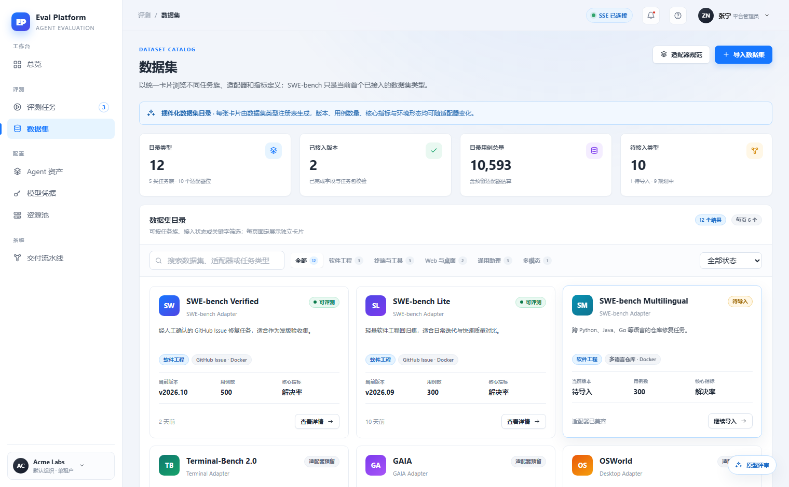
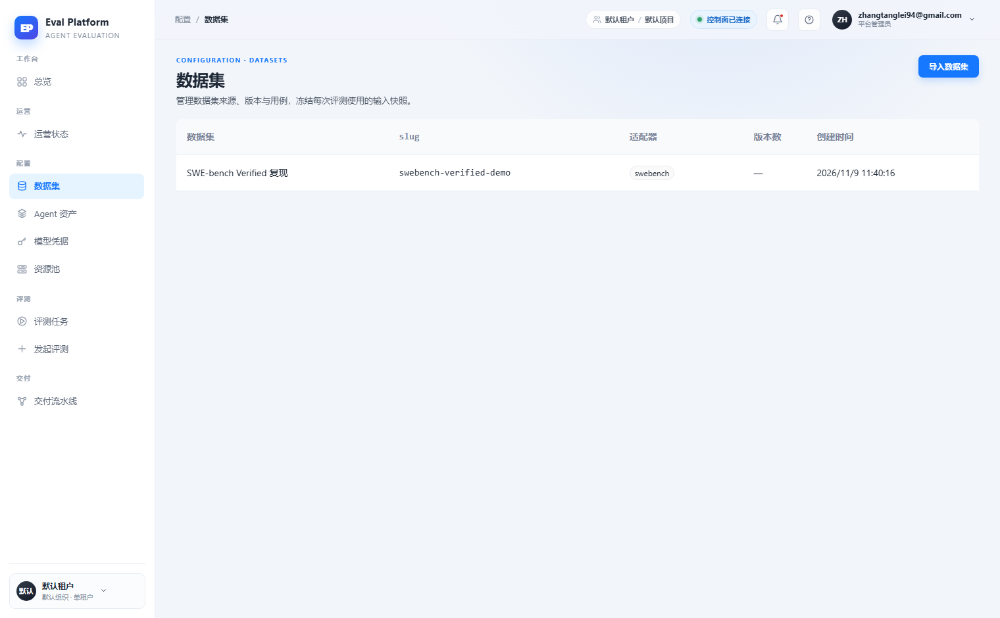

# Dataset index adapter cards with filters and pagination

English | [中文](m5-13-dataset-index-ui.md)

```yaml flow
kind: issue
milestone: m5
priority: P1
status: ready
scope:
  - .agents/flow/issues/m5-13-dataset-index-ui.*
  - .agents/flow/milestones/m5-product-workflows.*
  - .agents/notes/**
  - backend/**
  - web/**
  - tests/**
  - docs/**
  - reports/**
  - plans/**
  - scripts/doc-budgets.manifest.json
  - .gitignore
adr:
  - ../../notes/adr-0001-dataset-index-navigation.md
github:
  number: 141
  url: https://github.com/Shadow-Azure/ai-eval-platform/issues/141
```

## Background

The prototype designs the dataset index as an adapter-driven card grid: each card shows type name, task family tags, environment shape, current version, case count, core metrics and onboarding status, with task-family filter tabs, a status dropdown, search and pagination. The live implementation (2026-11-11 comparison report, `reports/2026-11-11/ui-vs-prototype/对比报告.md`) degraded into a plain 5-column table with no filters, pagination, status tags or stat cards. Evidence:

| Prototype | Live |
|---|---|
|  |  |

An information-architecture change was also found: the prototype places datasets under the "Evaluation" group (evaluation assets), while the live app moved them into "Configuration". Whether this was intentional needs an ADR.

## Goals

- Restore the adapter-driven card grid; card fields match the prototype: type name, task family, environment shape, version, case count, core metrics, onboarding status (evaluable / pending import / adapter reserved).
- Provide task-family filter tabs, a status dropdown, search and 6-cards-per-page pagination.
- Add the 4 top stat cards (index types / onboarded versions / total cases / pending types) and an "adapter spec" entry.
- Record an ADR for the "Evaluation → Configuration" group change: confirm or roll back.

## Acceptance

- Card fields match the prototype in visual comparison; data comes from the real adapter registry, not hardcoded values.
- Task-family filter, status filter, search and pagination compose correctly; empty results show an explicit empty state with a clear-filter action.
- Stat card numbers match actual index data.
- The group placement has an ADR conclusion reflected in the navigation.
