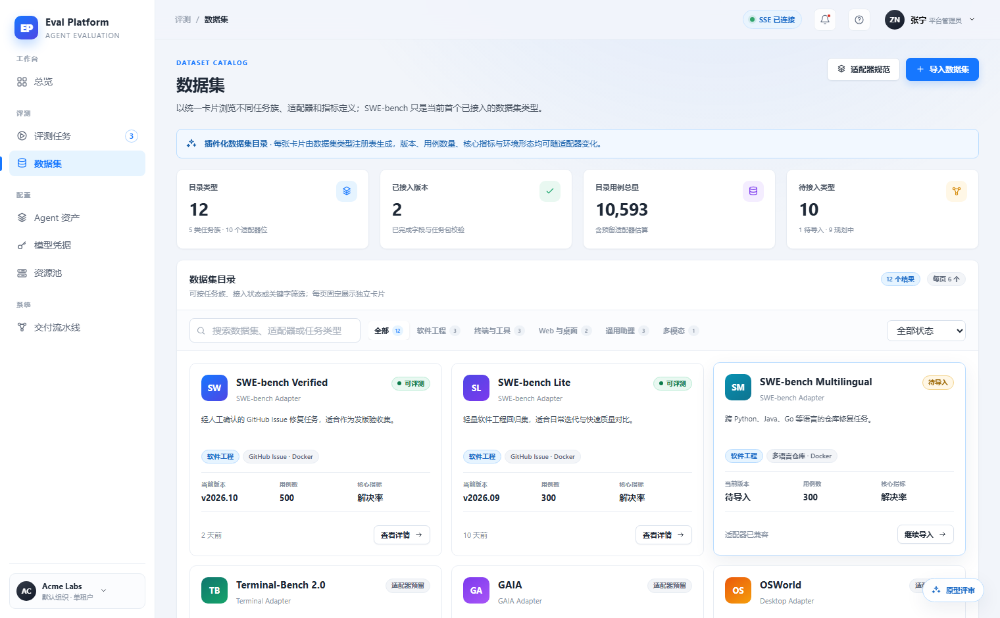
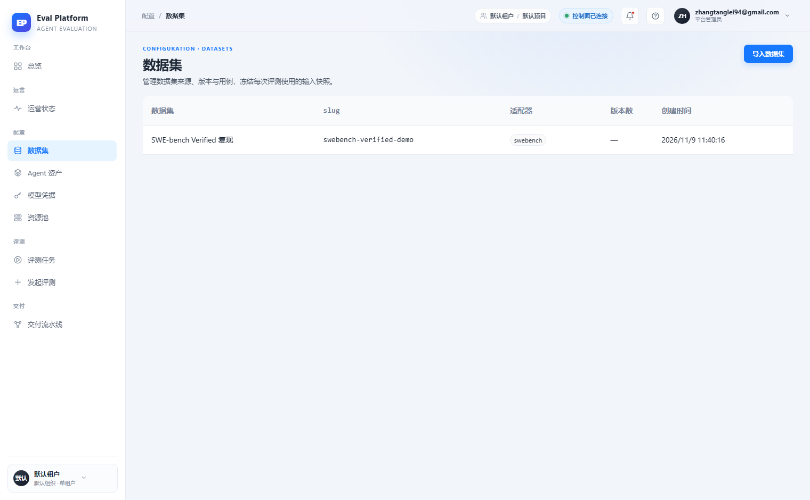

# 数据集目录适配器卡片目录与筛选分页

[English](m5-13-dataset-index-ui.en.md) | 中文

```yaml flow
kind: issue
milestone: m5
priority: P1
status: done
scope:
  - .agents/flow/issues/m5-13-dataset-index-ui.*
  - .agents/flow/milestones/m5-product-workflows.*
  - .agents/notes/**
  - backend/**
  - web/**
  - tests/**
  - docs/**
  - reports/**
  - plans/**
  - scripts/doc-budgets.manifest.json
  - .gitignore
adr:
  - ../../notes/adr-0001-dataset-index-navigation.md
github:
  number: 141
  url: https://github.com/Shadow-Azure/ai-eval-platform/issues/141
```

## 背景

原型将数据集目录设计为"适配器驱动"的卡片目录：每张卡片展示类型名称、任务族标签、环境形态、当前版本、用例数、核心指标与接入状态，并提供任务族筛选 Tab、状态下拉、搜索框和分页。线上实现（2026-11-11 对比报告，`reports/2026-11-11/ui-vs-prototype/对比报告.md`）退化为 5 列简单表格，无筛选、无分页、无状态标签、无统计卡。证据截图：

| 原型 | 线上 |
|---|---|
|  |  |

同时发现信息架构变化：原型中数据集属于"评测"分组（评测资产），线上被移入"配置"分组。此变更是否为有意设计需要 ADR 确认。

## 目标

- 恢复适配器驱动的卡片目录布局，卡片字段对齐原型：类型名称、任务族、环境形态、版本、用例数、核心指标、接入状态（可评测/待导入/适配器预留）。
- 提供任务族筛选 Tab、状态下拉、搜索框与每页 6 卡分页。
- 补齐顶部 4 张统计卡（目录类型数/已接入版本/用例总量/待接入）与"适配器规范"入口。
- 对"评测 → 配置"分组变更补一条 ADR：确认或回滚信息架构。

## 验收

- 目录页卡片字段与原型视觉对照一致，数据来自真实适配器注册表而非写死。
- 任务族筛选、状态筛选、搜索、分页组合使用正确，空结果有明确空态与清除入口。
- 统计卡数字与目录实际数据一致。
- 分组归属有 ADR 结论并落实在导航中。
