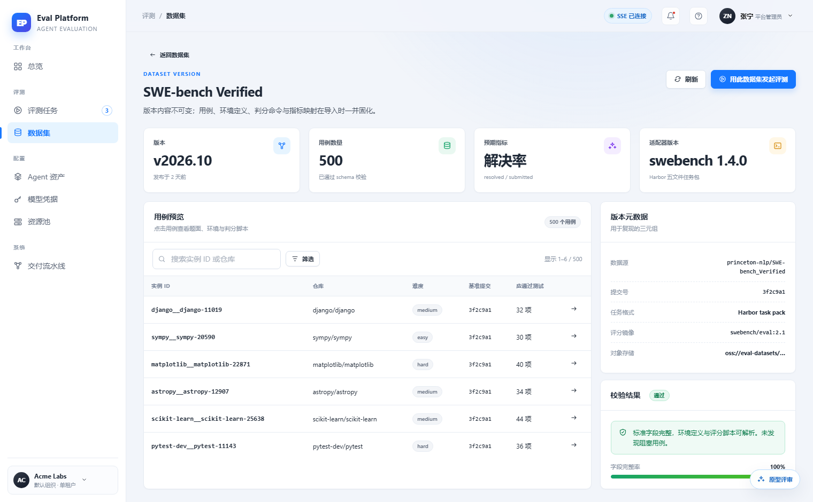
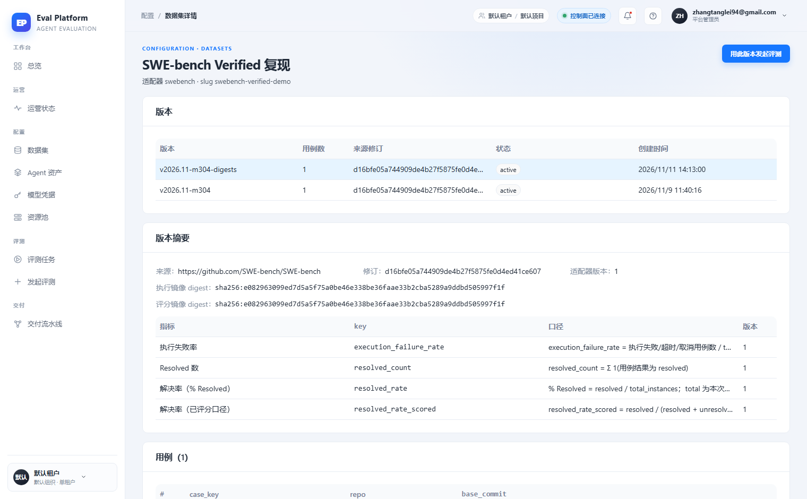

# Dataset case browser and validation status

English | [中文](m5-14-dataset-case-browser.md)

```yaml flow
kind: issue
milestone: m5
priority: P1
status: ready
scope:
  - .agents/flow/issues/m5-14-dataset-case-browser.*
  - .agents/flow/milestones/m5-product-workflows.*
  - backend/**
  - web/**
  - tests/**
  - docs/**
  - reports/**
  - plans/**
  - scripts/doc-budgets.manifest.json
adr: []
github:
  number: 142
  url: https://github.com/Shadow-Azure/ai-eval-platform/issues/142
```

## Background

The prototype designs a browsable case table on the dataset detail page: search by instance ID/repo, difficulty filter (easy/medium/hard), server-side pagination (500 SWE-bench Verified cases show page controls), plus a "validation passed / field completeness 100%" card and a refresh button. The live implementation (2026-11-11 comparison report) flattens cases into a raw table (case_key/repo/base_commit) with no search, filter, pagination or validation status; the page is unusable at 500-case scale. Evidence:

| Prototype | Live |
|---|---|
|  |  |

## Goals

- Case table supports search by instance ID/repo, difficulty filter and server-side pagination (20/50/100 per page).
- Show import validation results: pass/fail status and field completeness.
- Keep the live-only features: version list, version summary (source URL, commit, image digest) and metric definition table.
- Build the case browser as a reusable component for m5-17's "case detail" tab.
- Provide a refresh entry and a loading skeleton for the case table.

## Acceptance

- Any of the 500 SWE-bench Verified cases is reachable via search, filter and pagination.
- Validation status and field completeness come from real import-time validation records.
- Pagination and filtering are server-side; the full case list is never fetched at once.
- The case browser component is reused by m5-17 with no second implementation.
- Empty, loading and error states have screenshot comparison evidence.
