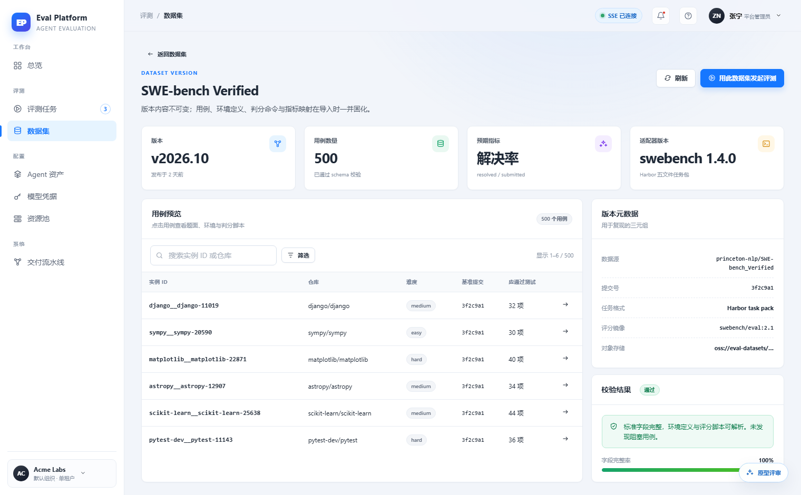
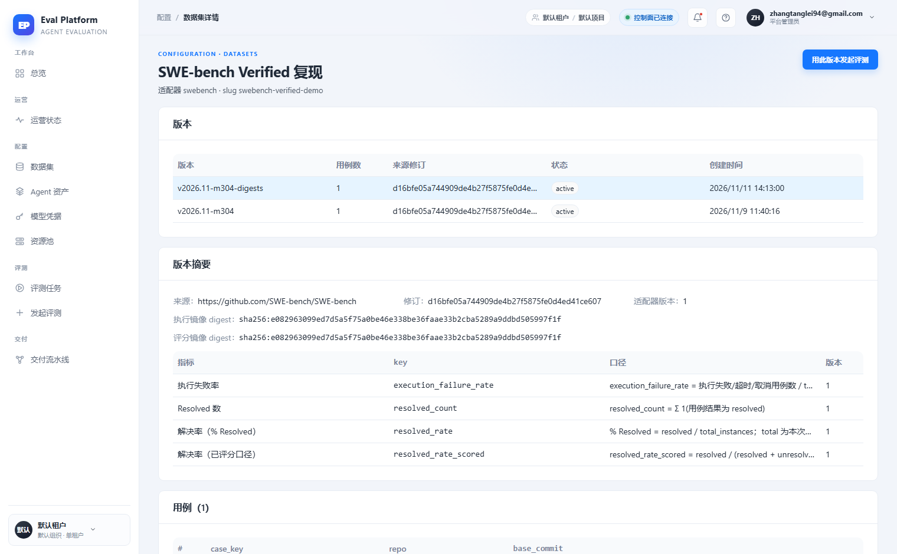

# 数据集详情用例浏览与校验状态

[English](m5-14-dataset-case-browser.en.md) | 中文

```yaml flow
kind: issue
milestone: m5
priority: P1
status: backlog
scope:
  - .agents/flow/issues/m5-14-dataset-case-browser.*
  - .agents/flow/milestones/m5-product-workflows.*
  - backend/**
  - web/**
  - tests/**
  - docs/**
  - reports/**
  - plans/**
  - scripts/doc-budgets.manifest.json
adr: []
github:
  number: null
  url: null
```

## 背景

原型为数据集详情页设计了可浏览的用例表：支持搜索实例 ID/仓库、按难度筛选（easy/medium/hard）、服务端分页（SWE-bench Verified 500 用例显示分页控件），并有"校验结果 通过 / 字段完整率 100%"卡与刷新按钮。线上实现（2026-11-11 对比报告）用例仅平铺原始表（case_key/repo/base_commit），无搜索、无筛选、无分页、无校验状态，500 用例规模下不可用。证据截图：

| 原型 | 线上 |
|---|---|
|  |  |

## 目标

- 用例表支持按实例 ID/仓库搜索、难度筛选与服务端分页（每页 20/50/100 可选）。
- 展示导入校验结果：通过/失败状态与字段完整率。
- 保留线上已实现的版本列表、版本摘要（来源 URL、commit、镜像 digest）与指标口径表。
- 用例浏览做成可复用组件，供 m5-17 评测详情"用例明细"页签直接复用。
- 提供用例表刷新入口与加载骨架屏。

## 验收

- SWE-bench Verified 500 用例可通过搜索、筛选、分页浏览到任意一条。
- 校验结果与字段完整率来自导入时的真实校验记录。
- 分页、筛选为服务端实现，不一次性拉全量数据。
- 用例浏览组件被 m5-17 复用，无第二套实现。
- 空态、加载态、错误态有截图对照证据。
