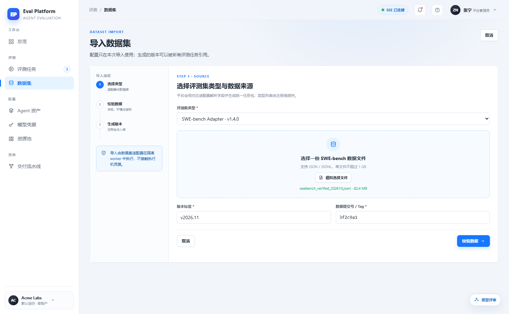
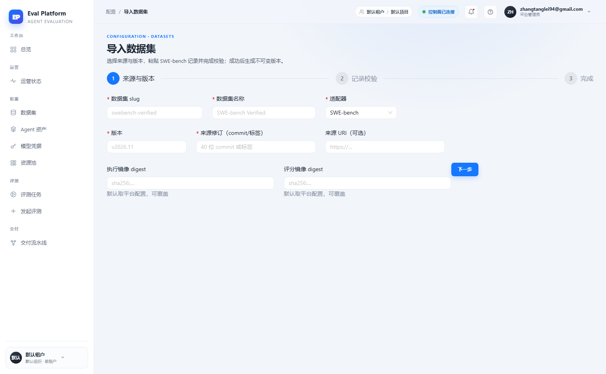

# Dataset import file upload and parse validation

English | [中文](m5-15-dataset-import-upload.md)

```yaml flow
kind: issue
milestone: m5
priority: P1
status: in-progress
scope:
  - .agents/flow/issues/m5-15-dataset-import-upload.*
  - .agents/flow/milestones/m5-product-workflows.*
  - backend/**
  - web/**
  - tests/**
  - docs/**
  - reports/**
  - plans/**
  - scripts/doc-budgets.manifest.json
  - pyproject.toml
  - docker-compose.yml
  - deploy/**
  - .gitignore
adr: []
github:
  number: 143
  url: https://github.com/Shadow-Azure/ai-eval-platform/issues/143
```

## Background

The prototype designs "import dataset" as a three-step wizard: pick the adapter → upload the data file (JSON/JSONL, ≤1GB, drag-and-drop zone) with version label and data commit → parse and validate in an isolated worker, then generate an immutable version, with a security notice card and a validation report. The live implementation (2026-11-11 comparison report) degraded into a metadata-only form (slug/adapter/source URI/image digest) with **no file upload zone**; the core "upload → parse → validate" flow is missing. The step bar also changed from a left vertical stepper (with descriptions) to a top horizontal one, and there is no explicit cancel entry. Evidence:

| Prototype | Live |
|---|---|
|  |  |

## Goals

- Step one provides data-file upload (JSON/JSONL, ≤1GB, drag-and-drop) with format validation tied to the selected adapter.
- Parsing and validation run in an isolated worker, producing a validation report (pass/fail items, field completeness) shown in step two.
- After validation passes, generate an immutable version (version triple + task package); on failure the user can fix and re-upload.
- Keep the live-added slug and image digest fields.
- Provide an explicit cancel/exit entry; step descriptions match the prototype copy.

## Acceptance

- A version cannot be created without uploading a file; a real import walks the full upload → validate → generate flow once.
- Validation failure shows an itemized error report and never produces a partial version.
- Isolated execution has timeout and resource limits; failures do not affect the control plane.
- Cancel entry, empty, uploading/validating/failure states have screenshot comparison evidence.
