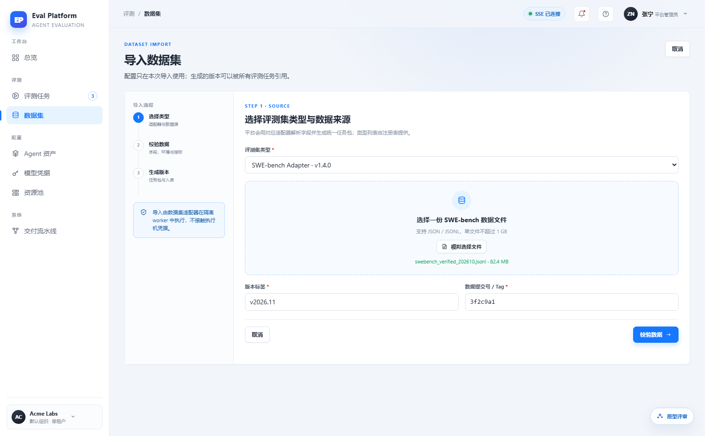
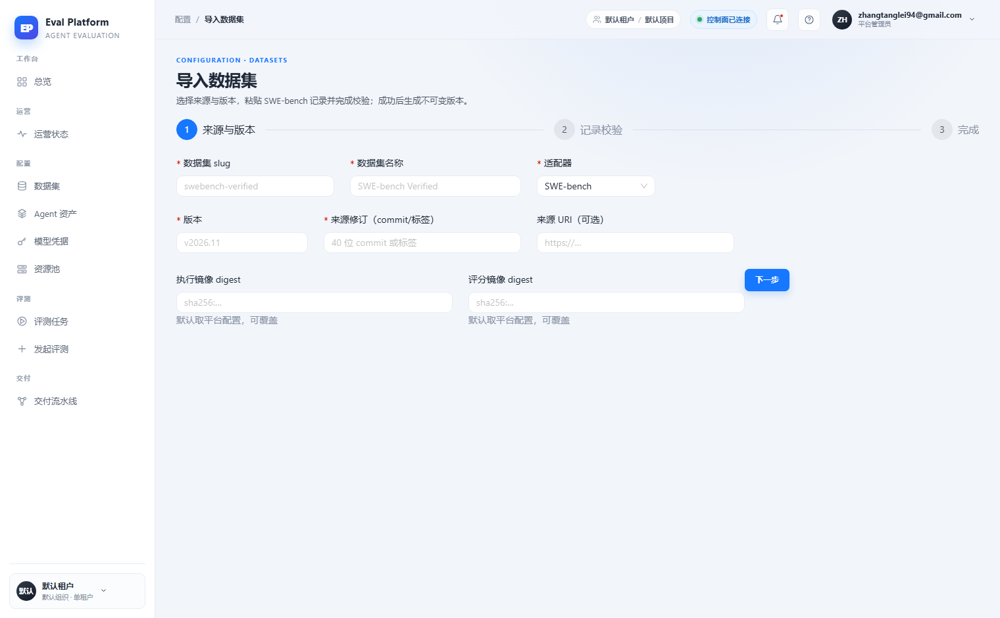

# 数据集导入文件上传与解析校验

[English](m5-15-dataset-import-upload.en.md) | 中文

```yaml flow
kind: issue
milestone: m5
priority: P1
status: in-progress
scope:
  - .agents/flow/issues/m5-15-dataset-import-upload.*
  - .agents/flow/milestones/m5-product-workflows.*
  - backend/**
  - web/**
  - tests/**
  - docs/**
  - reports/**
  - plans/**
  - scripts/doc-budgets.manifest.json
  - pyproject.toml
  - docker-compose.yml
  - deploy/**
  - .gitignore
adr: []
github:
  number: 143
  url: https://github.com/Shadow-Azure/ai-eval-platform/issues/143
```

## 背景

原型将"导入数据集"设计为三步向导：选择适配器 → 上传数据文件（JSON/JSONL，≤1GB，拖放区）并填写版本标签与数据提交号 → 在隔离 worker 中解析校验后生成不可变版本，含安全提示卡与校验报告。线上实现（2026-11-11 对比报告）退化为纯元信息表单（slug/适配器/来源 URI/镜像 digest），**没有文件上传区**，"上传 → 解析 → 校验"的核心流程缺失；步骤条从左侧竖向（含说明）改为顶部横向，且无显式取消入口。证据截图：

| 原型 | 线上 |
|---|---|
|  |  |

## 目标

- 第一步提供数据文件上传（JSON/JSONL，≤1GB，支持拖放），与适配器选择联动校验格式。
- 解析与校验在隔离 worker 中执行，产出校验报告（通过/失败项、字段完整率）并展示在第二步。
- 校验通过后生成不可变版本（版本三元组 + 任务包），失败时可修正后重新上传。
- 保留线上新增的 slug 与镜像 digest 字段。
- 向导提供显式取消/退出入口，步骤说明对齐原型文案。

## 验收

- 用户不上传文件无法生成版本；上传 → 校验 → 生成版本全流程可走通一次真实导入。
- 校验失败时有逐项错误报告，不产生半成品版本。
- 隔离执行有超时与资源上限，失败不影响控制面服务。
- 取消入口、空态、上传中/校验中/失败态有截图对照证据。
