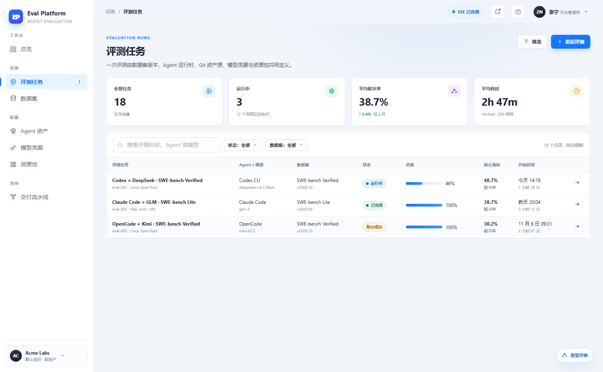
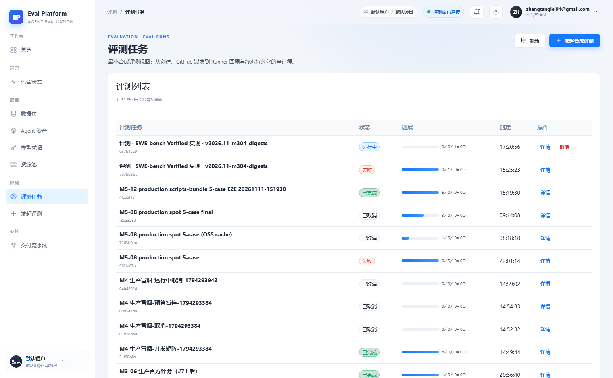

# Eval list stats, filters and partial-success status

English | [中文](m5-16-eval-list-overview.md)

```yaml flow
kind: issue
milestone: m5
priority: P1
status: ready
scope:
  - .agents/flow/issues/m5-16-eval-list-overview.*
  - .agents/flow/milestones/m5-product-workflows.*
  - backend/**
  - web/**
  - tests/**
  - docs/**
  - reports/**
  - plans/**
  - scripts/doc-budgets.manifest.json
adr: []
github:
  number: 144
  url: https://github.com/Shadow-Azure/ai-eval-platform/issues/144
```

## Background

The prototype designs the eval run list with 4 stat cards (total/running/average resolve rate/average duration), a search box, status/dataset filters, and columns for Agent/model, dataset version, core metric (resolve rate) and start time/duration. It also introduces a "partial success" status: when some cases fail, the final result and failure count are expressed together instead of masquerading as full success (see `prototype/README.md` design trade-offs). The live implementation (2026-11-11 comparison report) has no stat cards or filters; the table only has status/progress/created/actions columns, and the status enum is limited to running/failed/completed/cancelled. Evidence:

| Prototype | Live |
|---|---|
|  |  |

## Goals

- Add the 4 stat cards, search box, and status/dataset filters.
- Complete the columns: Agent/model, dataset version, core metric (resolve rate), start time/duration.
- Introduce "partial success" into the status enum: finalize it first in the backend run status model (shared with m5-17 via one ADR), and render strictly from the enum on the frontend — no frontend-fabricated status.
- Keep the live-only inline "cancel" action and auto refresh.

## Acceptance

- Stat cards, filters and search compose correctly; implemented server-side.
- A run with both resolved and failed cases shows "partial success", not "failed" or "completed".
- The status enum has an ADR referenced by both m5-16 and m5-17.
- Empty and no-filter-result states have screenshot comparison evidence.
