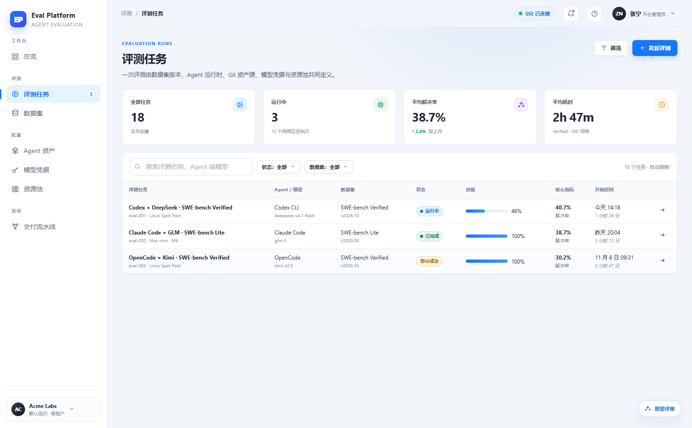
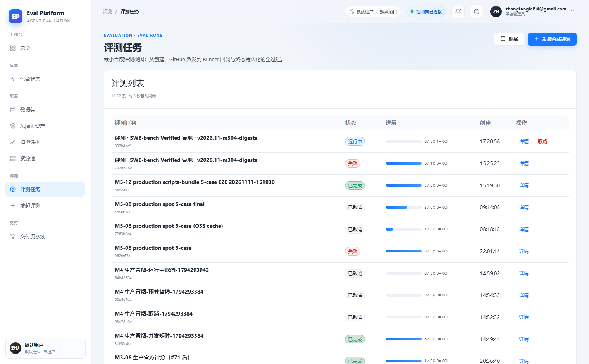

# 评测列表统计筛选与部分成功状态

[English](m5-16-eval-list-overview.en.md) | 中文

```yaml flow
kind: issue
milestone: m5
priority: P1
status: ready
scope:
  - .agents/flow/issues/m5-16-eval-list-overview.*
  - .agents/flow/milestones/m5-product-workflows.*
  - backend/**
  - web/**
  - tests/**
  - docs/**
  - reports/**
  - plans/**
  - scripts/doc-budgets.manifest.json
  - .gitignore
adr: []
github:
  number: 144
  url: https://github.com/Shadow-Azure/ai-eval-platform/issues/144
```

## 背景

原型为评测任务列表设计了 4 张统计卡（全部任务/运行中/平均解决率/平均耗时）、搜索框与状态/数据集筛选，列表列含 Agent/模型、数据集版本、核心指标（解决率）、开始时间/耗时，并引入"部分成功"状态（部分用例失败时最终结果与失败数同时表达，避免伪装成全量成功——见 `prototype/README.md` 设计取舍）。线上实现（2026-11-11 对比报告）无统计卡、无搜索筛选，列表只有状态/进度/创建时间/操作四列，且状态枚举仅有运行中/失败/已完成/已取消。证据截图：

| 原型 | 线上 |
|---|---|
|  |  |

## 目标

- 补齐 4 张统计卡与搜索框、状态/数据集筛选。
- 列表补齐列：Agent/模型、数据集版本、核心指标（解决率）、开始时间/耗时。
- 状态枚举引入"部分成功"：先在后端任务状态模型定稿（与 m5-17 共享同一枚举与 ADR），前端按枚举渲染，禁止前端伪造。
- 保留线上的行内"取消"操作与自动刷新。

## 验收

- 统计卡、筛选、搜索组合查询结果正确，服务端实现。
- 一批同时含成功与失败用例的评测在列表中显示"部分成功"而非"失败"或"已完成"。
- 状态枚举有 ADR 记录并被 m5-16/m5-17 共同引用。
- 空态与筛选无结果态有截图对照证据。
