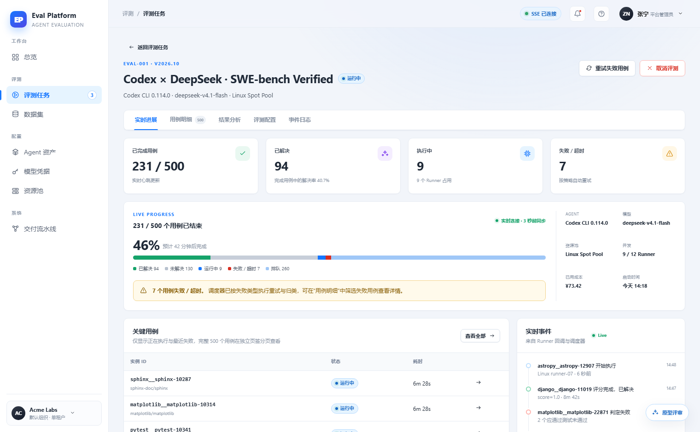
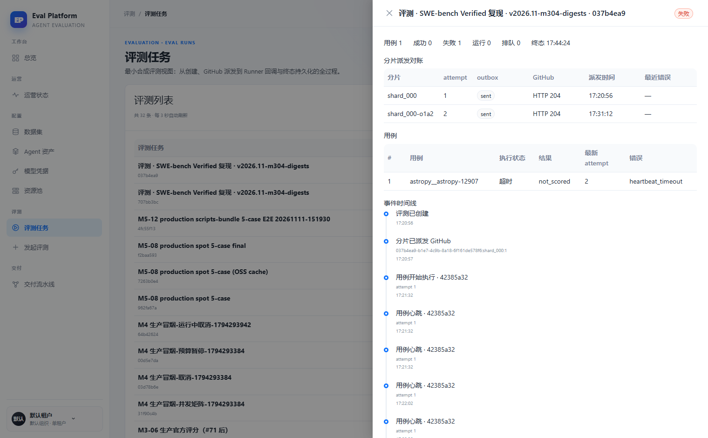

# Restore eval detail route and results analysis

English | [中文](m5-17-eval-detail-entry.md)

```yaml flow
kind: issue
milestone: m5
priority: P1
status: ready
scope:
  - .agents/flow/issues/m5-17-eval-detail-entry.*
  - .agents/flow/milestones/m5-product-workflows.*
  - backend/**
  - web/**
  - tests/**
  - docs/**
  - reports/**
  - plans/**
  - scripts/doc-budgets.manifest.json
adr: []
github:
  number: 145
  url: https://github.com/Shadow-Azure/ai-eval-platform/issues/145
```

## Background

The prototype designs eval detail as a standalone route page (`#/evals/eval-001`) with five tabs: live progress, case detail, results analysis, eval config and event log; the header has 4 stat cards, a status-stacked progress bar (legend/queued count/ETA), and model/resource pool/concurrency/cost panels, plus "retry failed cases". The live implementation (2026-11-11 comparison report) degrades the entry into a right-side Drawer on the list page (shard reconciliation → case table → event timeline), with no metric aggregation, no results analysis, no retry; the `/evals/:id` route in `web/src/app/routes.tsx` and `EvalDetailPage.tsx` exist but are unreachable (dead code). Evidence:

| Prototype | Live drawer |
|---|---|
|  |  |

Note: local main already contains the m5-05 results workbench and m6-05 trace viewer code, while the deployed environment lags behind (the overview shows "M3 in progress"). Verify the deployment version before starting to avoid duplicate work.

## Goals

- Restore `/evals/:id` as the single detail entry (the list "detail" button navigates to the route); remove the Drawer or keep it as a quick preview (ADR decision).
- Restore the five tabs; live progress keeps SSE; case detail reuses the m5-14 case browser component.
- Header stat cards and the status-stacked progress bar come from server-side aggregation (resolve rate, failed/timeout counts, ETA); the status enum shares one ADR with m5-16.
- Provide "retry failed cases" via a backend API, bounded by budget/capacity checks.
- Keep the live increments: the shard reconciliation table and attempt heartbeat timeline (in the event log or a dedicated tab), and feed them back into the prototype docs.
- Wire the entry from a case row to the trace viewer (m6-05).

## Acceptance

- The deep link `/evals/:id` opens the detail page and survives refresh.
- Metrics, progress and ETA come from server-side aggregation, not frontend assembly.
- Retrying failed cases creates new attempt records; budget/capacity shortfalls show explicit errors.
- Shard reconciliation and heartbeat timeline are visible on the detail page.
- A failed case leads to its session trace page.
- Dead code is removed; `verify:flow` and frontend tests are green.
