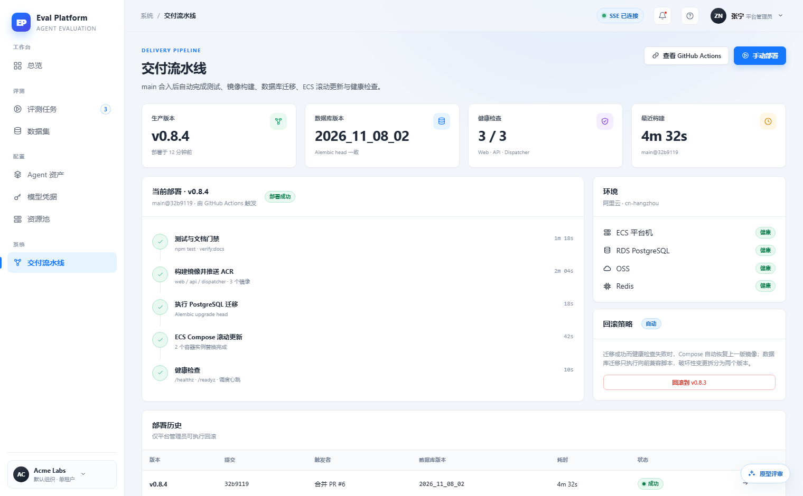
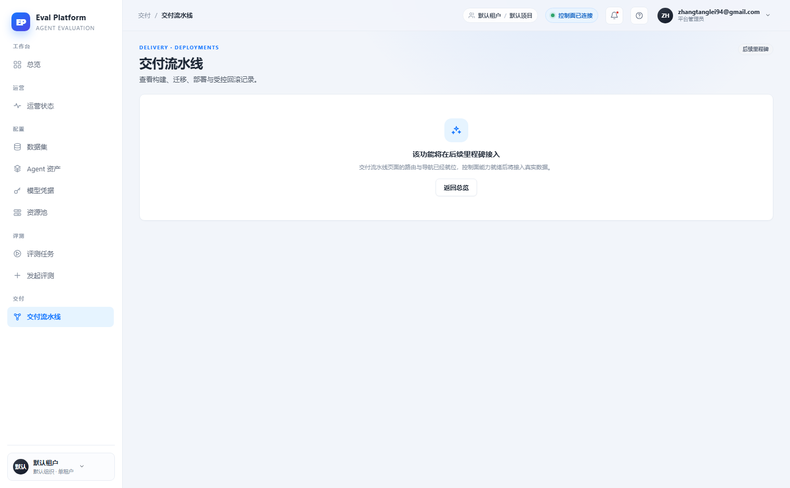
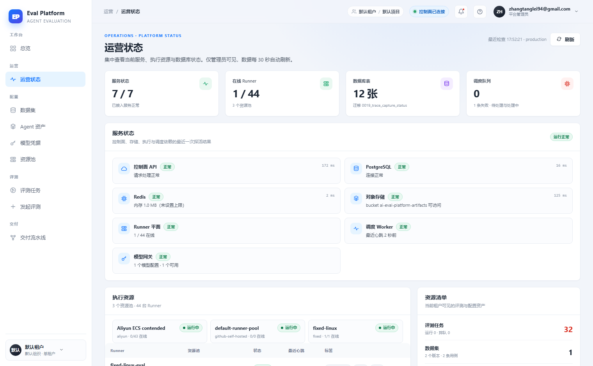

# Delivery pipeline page with controlled rollback

English | [中文](m5-18-deployments-page.md)

```yaml flow
kind: issue
milestone: m5
priority: P1
status: ready
scope:
  - .agents/flow/issues/m5-18-deployments-page.*
  - .agents/flow/milestones/m5-product-workflows.*
  - backend/**
  - web/**
  - tests/**
  - docs/**
  - reports/**
  - plans/**
  - scripts/doc-budgets.manifest.json
adr: []
github:
  number: 146
  url: https://github.com/Shadow-Azure/ai-eval-platform/issues/146
```

## Background

The prototype designs "delivery pipeline" as a full page: four summary cards (production version/database version/health check/latest build), a five-stage step timeline (test → ACR → DB migration → ECS rolling update → health check), environment component health, rollback policy description with a "rollback to previous version" danger action (irreversible scope must be stated), and a deployment history table. The live implementation (2026-11-11 comparison report) keeps `/deployments` as a placeholder page ("this feature will arrive in a later milestone"); the pipeline, deployment history and rollback entry are all missing, while environment health moved to the separate admin "operations" page. The m2-02 delivery pipeline backend and GitHub Actions are already done — only the frontend page is missing. Evidence:

| Prototype | Live placeholder | Live operations |
|---|---|---|
|  |  |  |

## Goals

- Replace the `/deployments` placeholder with a real page: four summary cards + five-stage timeline + deployment history table, driven by real deployment records (GitHub Actions / migration history) — never fabricated on the frontend.
- Provide a controlled rollback action: second confirmation + irreversible scope and incurred cost statement (aligned with the danger-action state matrix in `prototype/README.md`), platform-admin only.
- Record an ADR defining the responsibility boundary between this page and the "operations" page (`/operations`) for deployment health, avoiding duplication.
- Provide an external link to GitHub Actions.

## Acceptance

- Deployment history, current version and migration version match the actual GitHub Actions state.
- Rollback requires a second confirmation, is audit-logged, and is invisible to non-admins.
- The five pipeline stages map one-to-one to the latest deployment.
- Empty (no deployment records) and loading states have screenshot comparison evidence.
