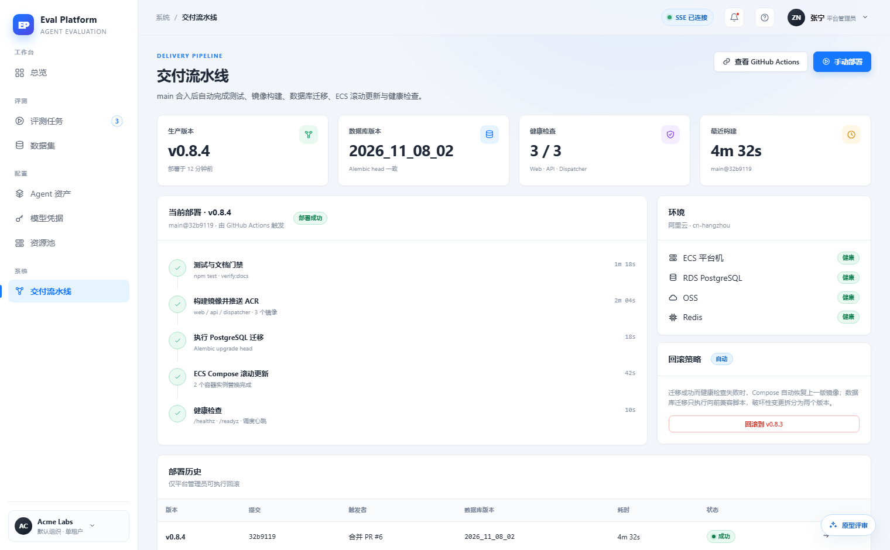
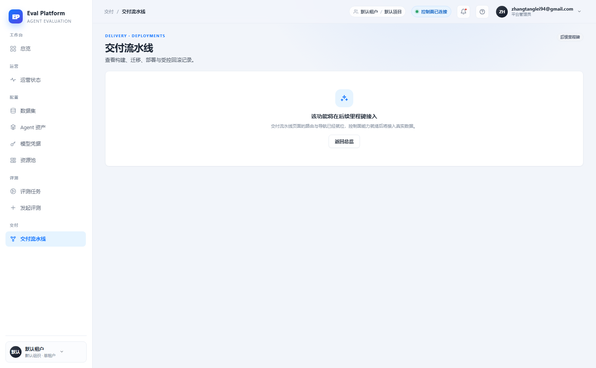
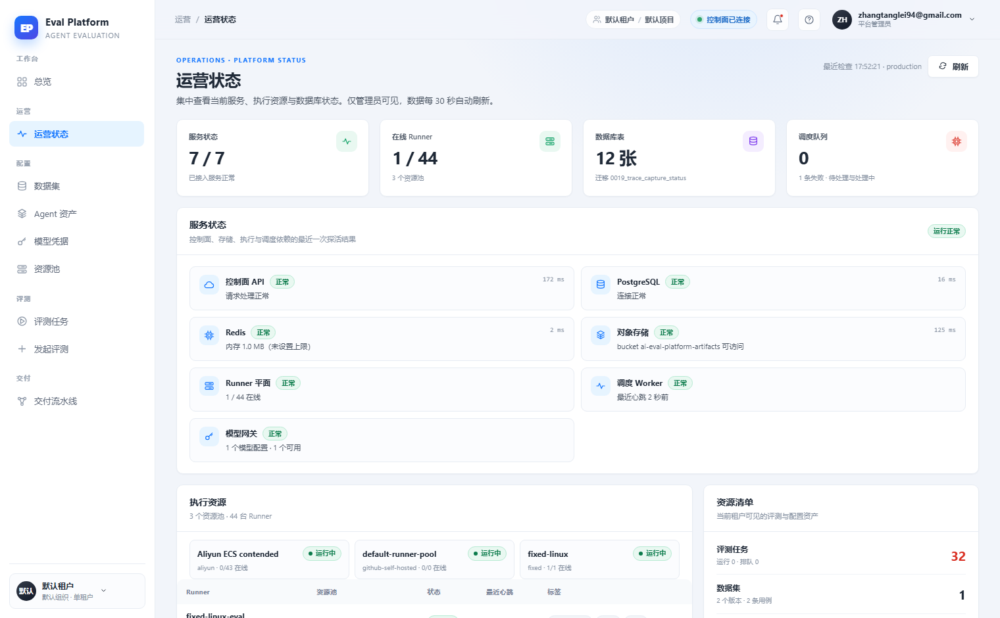

# 交付流水线页面与受控回滚

[English](m5-18-deployments-page.en.md) | 中文

```yaml flow
kind: issue
milestone: m5
priority: P1
status: done
scope:
  - .agents/flow/issues/m5-18-deployments-page.*
  - .agents/flow/milestones/m5-product-workflows.*
  - .agents/notes/**
  - .github/workflows/**
  - deploy/**
  - backend/**
  - web/**
  - tests/**
  - docs/**
  - reports/**
  - plans/**
  - scripts/doc-budgets.manifest.json
  - .gitignore
adr:
  - ../../notes/adr-0002-deployment-health-boundary.md
github:
  number: 146
  url: https://github.com/Shadow-Azure/ai-eval-platform/issues/146
```

## 背景

原型将"交付流水线"设计为完整页面：生产版本/数据库版本/健康检查/最近构建四张摘要卡、五阶段步骤时间线（测试 → ACR → 数据库迁移 → ECS 滚动更新 → 健康检查）、环境组件健康、回滚策略说明与"回滚到上一版本"危险操作（需说明不可逆范围）、部署历史表。线上实现（2026-11-11 对比报告）`/deployments` 是占位页（"该功能将在后续里程碑接入"），流水线、部署历史、回滚入口全部缺失；环境健康被拆到独立的管理员"运营状态"页。m2-02 交付流水线后端与 GitHub Actions 已完成，缺的是前端页面。证据截图：

| 原型 | 线上占位页 | 线上运营状态 |
|---|---|---|
|  |  |  |

## 目标

- 用真实页面替换 `/deployments` 占位页：四张摘要卡 + 五阶段时间线 + 部署历史表，数据来自真实部署记录（GitHub Actions / 迁移历史），不在前端伪造。
- 提供受控回滚操作：二次确认 + 不可逆范围与已产生费用说明（对齐 `prototype/README.md` 危险操作状态矩阵），仅限平台管理员。
- 用 ADR 明确部署健康信息在本页与"运营状态"页（`/operations`）的职责边界，避免两页重复。
- 提供跳转 GitHub Actions 的外链入口。

## 验收

- 部署历史、当前版本、迁移版本与 GitHub Actions 实际状态一致。
- 回滚操作需要二次确认，执行后有审计记录；非管理员不可见。
- 流水线时间线五个阶段状态与最近一次部署一一对应。
- 页面空态（无部署记录）与加载态有截图对照证据。
