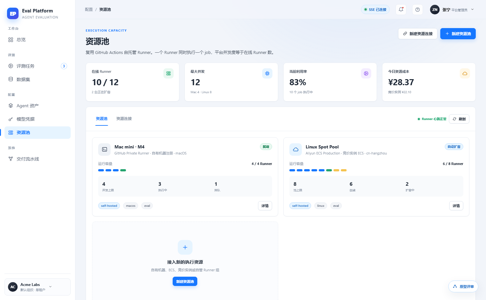
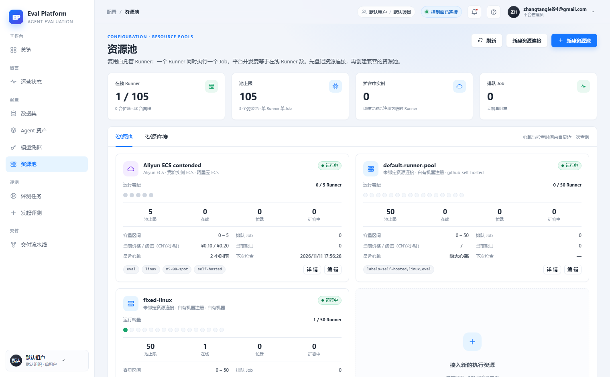

# Resource pool cost, utilization and queue visualization

English | [中文](m5-19-resource-pool-readability.md)

```yaml flow
kind: issue
milestone: m5
priority: P2
status: ready
scope:
  - .agents/flow/issues/m5-19-resource-pool-readability.*
  - .agents/flow/milestones/m5-product-workflows.*
  - backend/**
  - web/**
  - tests/**
  - docs/**
  - reports/**
  - plans/**
  - scripts/doc-budgets.manifest.json
adr: []
github:
  number: 147
  url: https://github.com/Shadow-Azure/ai-eval-platform/issues/147
```

## Background

The prototype's resource pool page emphasizes a human-readable status narrative: stat cards include current utilization and today's resource cost, the pool capacity bar uses colored segments for online/busy/queued (queued in yellow), and pool status distinguishes "ready / auto-scaling" to expose queue risk before capacity runs out (the "capacity shortage" row of the `prototype/README.md` state matrix). The live implementation (2026-11-11 comparison report) replaced this with four raw numbers (pool limit/online/busy/scaling) and an almost all-grey capacity dot matrix; utilization and cost disappeared and queue-risk visualization weakened. The live-added ops fields (heartbeat/check time, price thresholds) should be kept. Evidence:

| Prototype | Live |
|---|---|
|  |  |

## Goals

- Stat cards restore current utilization and today's resource cost (aligned with the m5-10 unified CNY billing), driven by real backend values.
- The pool capacity bar uses colored segments: online/busy/queued (yellow)/offline, consistent with the legend and stats.
- Pool status distinguishes "ready / auto-scaling", with a warning expression when queued jobs exceed a threshold.
- Keep the live-added ops detail fields and the "edit" capability.

## Acceptance

- A queue-risk scenario (online near pool limit, queued jobs > 0) has an explicit visual expression on the pool card.
- Utilization and cost numbers are reproducible from backend data.
- Capacity segment colors match the legend; status matches actual runner heartbeats.
- Before/after screenshots provide comparison evidence for the key views.
