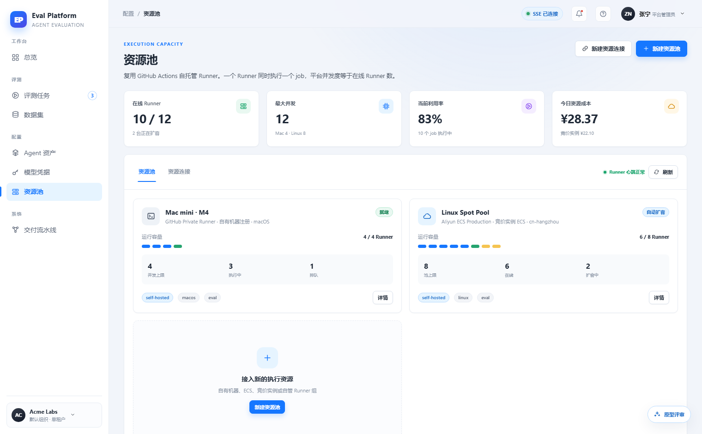
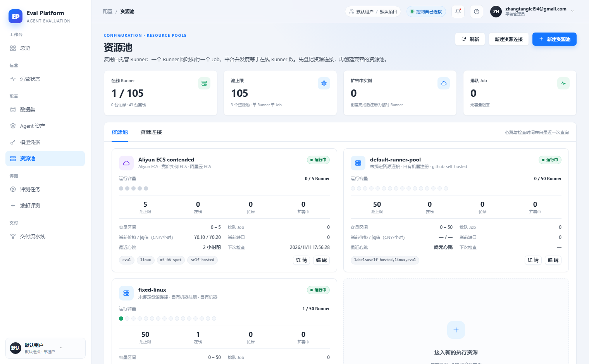

# 资源池成本利用率与排队可视化

[English](m5-19-resource-pool-readability.en.md) | 中文

```yaml flow
kind: issue
milestone: m5
priority: P2
status: ready
scope:
  - .agents/flow/issues/m5-19-resource-pool-readability.*
  - .agents/flow/milestones/m5-product-workflows.*
  - backend/**
  - web/**
  - tests/**
  - docs/**
  - reports/**
  - plans/**
  - scripts/doc-budgets.manifest.json
adr: []
github:
  number: 147
  url: https://github.com/Shadow-Azure/ai-eval-platform/issues/147
```

## 背景

原型的资源池页强调"人读的状态叙事"：统计卡含当前利用率与今日资源成本，池容量条用彩色分段表达在线/忙碌/排队（排队为黄色），池状态区分"就绪/自动扩容"，用于在容量不足前暴露排队风险（`prototype/README.md` 状态矩阵"容量不足"）。线上实现（2026-11-11 对比报告）替换为池上限/在线/忙碌/扩容中四个原始数值 + 容量点阵几乎全灰，利用率与成本维度消失，排队风险可视化弱化；同时新增了心跳/检查时间、价格阈值等真实运维字段（应保留）。证据截图：

| 原型 | 线上 |
|---|---|
|  |  |

## 目标

- 统计卡恢复当前利用率与今日资源成本（关联 m5-10 统一计费口径），数据来自后端真实值。
- 池容量条改为彩色分段：在线/忙碌/排队（黄）/离线，并与图例和统计一致。
- 池状态区分"就绪/自动扩容中"，排队 Job 超过阈值时有预警表达。
- 保留线上新增的运维明细字段与"编辑"能力。

## 验收

- 排队风险场景（在线数接近池上限、排队 Job > 0）在池卡片上有明确的可视化表达。
- 利用率与成本数字可由后端数据复算验证。
- 容量分段颜色与图例一致，状态与实际 Runner 心跳一致。
- 改造前后关键界面有截图对照证据。
