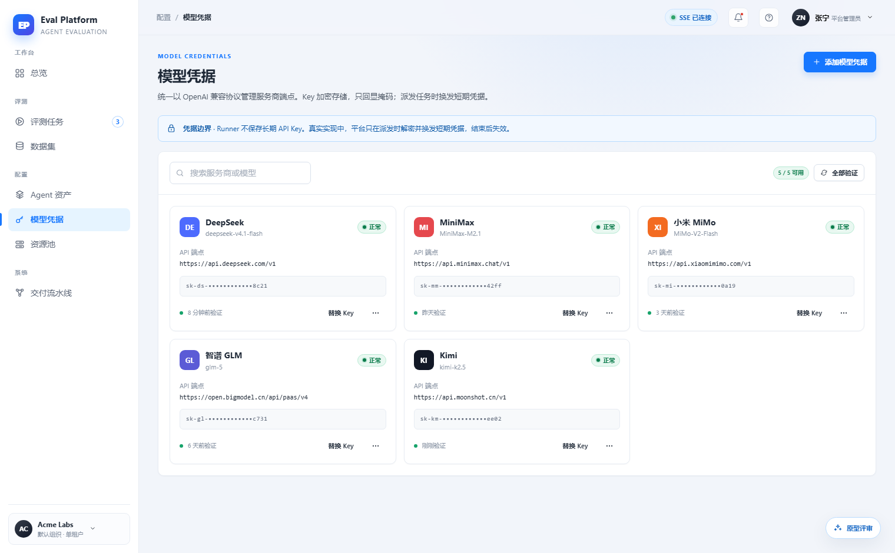
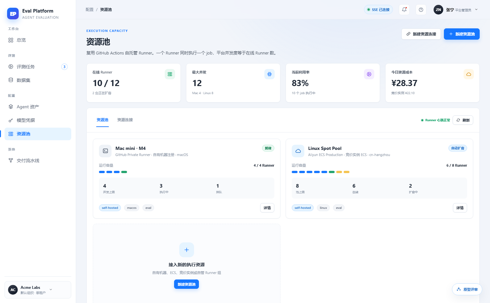
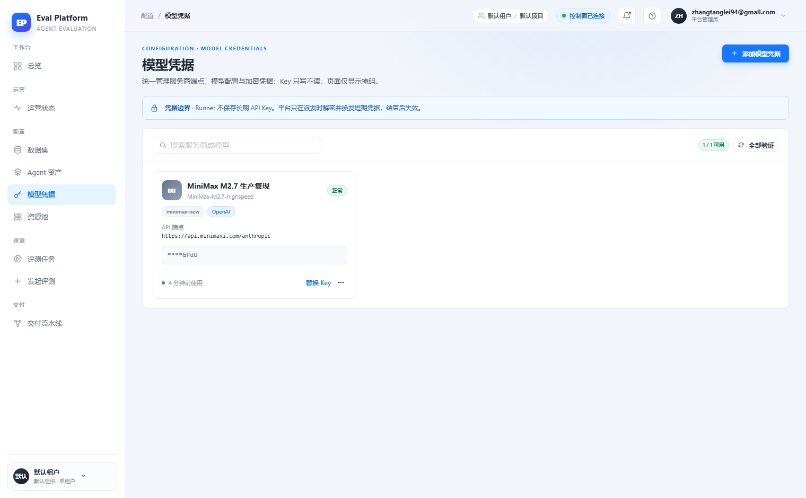

# Frontend edge states coverage

English | [中文](m5-20-ui-edge-states.md)

```yaml flow
kind: issue
milestone: m5
priority: P2
status: ready
scope:
  - .agents/flow/issues/m5-20-ui-edge-states.*
  - .agents/flow/milestones/m5-product-workflows.*
  - backend/**
  - web/**
  - tests/**
  - docs/**
  - reports/**
  - plans/**
  - scripts/doc-budgets.manifest.json
adr: []
github:
  number: 148
  url: https://github.com/Shadow-Azure/ai-eval-platform/issues/148
```

## Background

`prototype/README.md` defines a UI state matrix (empty, loading, failed, no-permission, partial success, dangerous action, credential masking, capacity shortage, connection capability mismatch, unresolved ref, missing runtime prerequisites, trace degradation). The 2026-11-11 comparison report found the live implementation covers it poorly: no "no search results" empty state on model credentials, no "locked state + permission request" for resource connection keys, no "missing runtime prerequisites" marking for agent assets (OpenSpec CLI/generative command deps), and weakened capacity-shortage queue risk (handled separately in m5-19). Evidence:

| Prototype empty-state example | Prototype edge states | Live credentials |
|---|---|---|
|  |  |  |

## Goals

- Build an edge-state acceptance checklist mapped row-by-row to the `prototype/README.md` state matrix.
- Fill the four missing state classes: no-search-results empty state (with clear-filter), resource connection key locked state with permission request entry, agent-asset missing-runtime-prerequisite marking, danger-action confirmation copy (irreversible scope + incurred cost).
- Each state is triggered by real permissions/data; no frontend-fabricated states.
- This issue owns the checklist; concrete implementations ship with each page in m5-13 ~ m5-19.

## Acceptance

- Every state-matrix row is marked in the checklist as implemented (with screenshot evidence) or not-applicable (with a reason).
- Each of the four missing state classes has a reproducible demo path (account, steps, expected UI).
- The locked state for restricted roles is verified with a real limited account.
- All screenshot evidence is archived under `reports/` and linked from the checklist.
