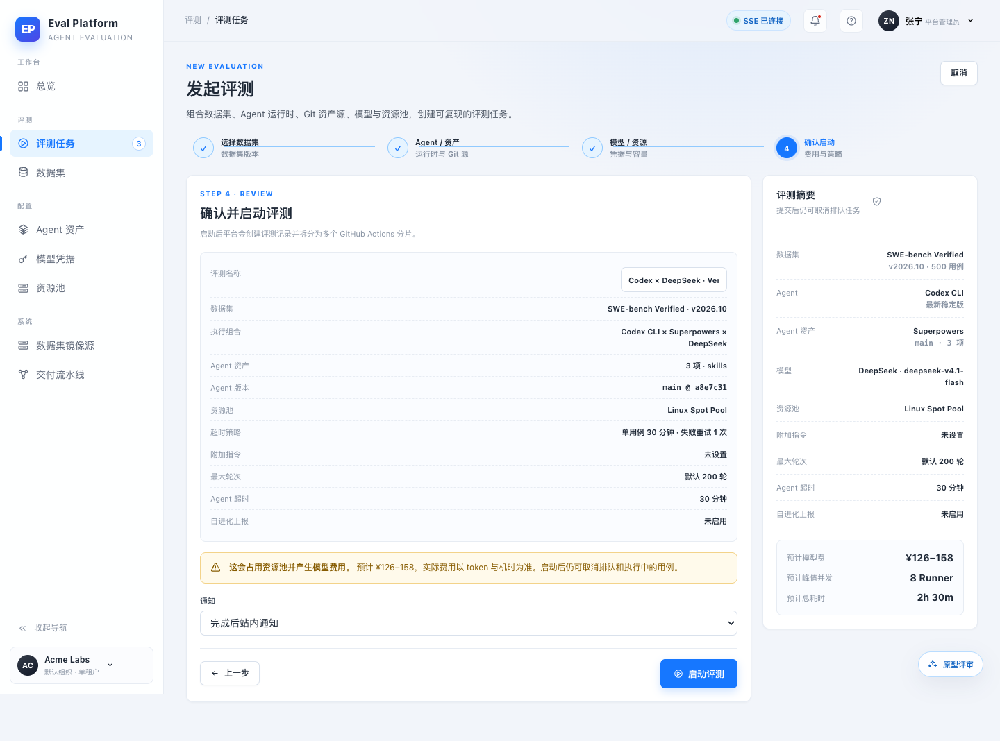
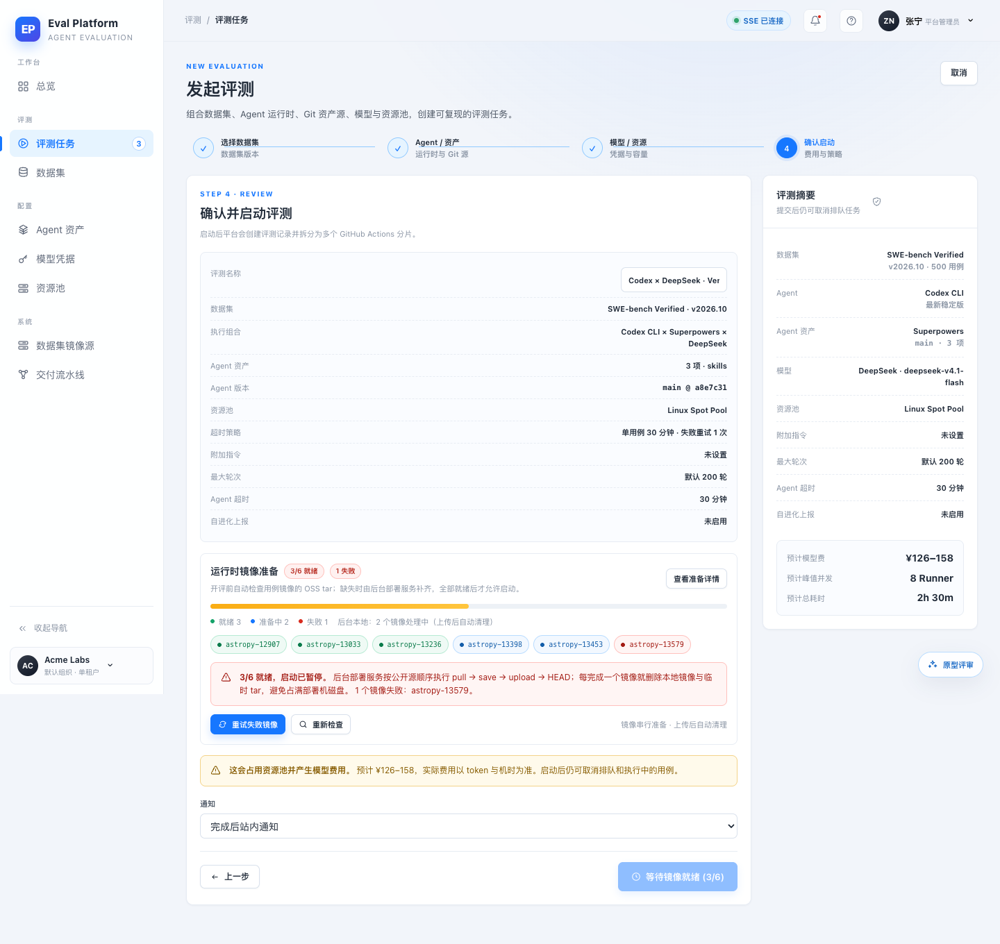
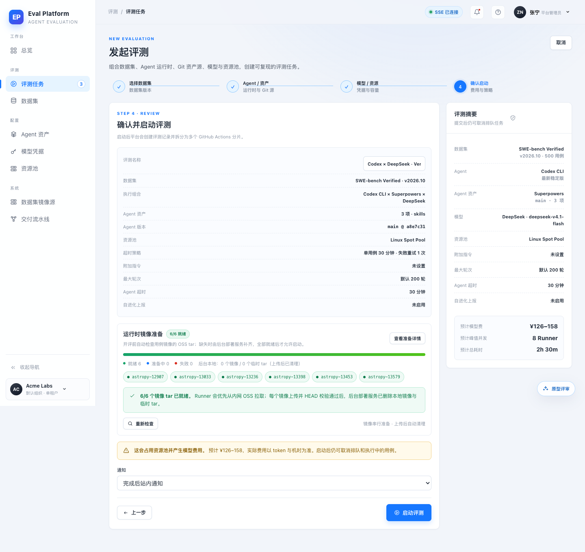
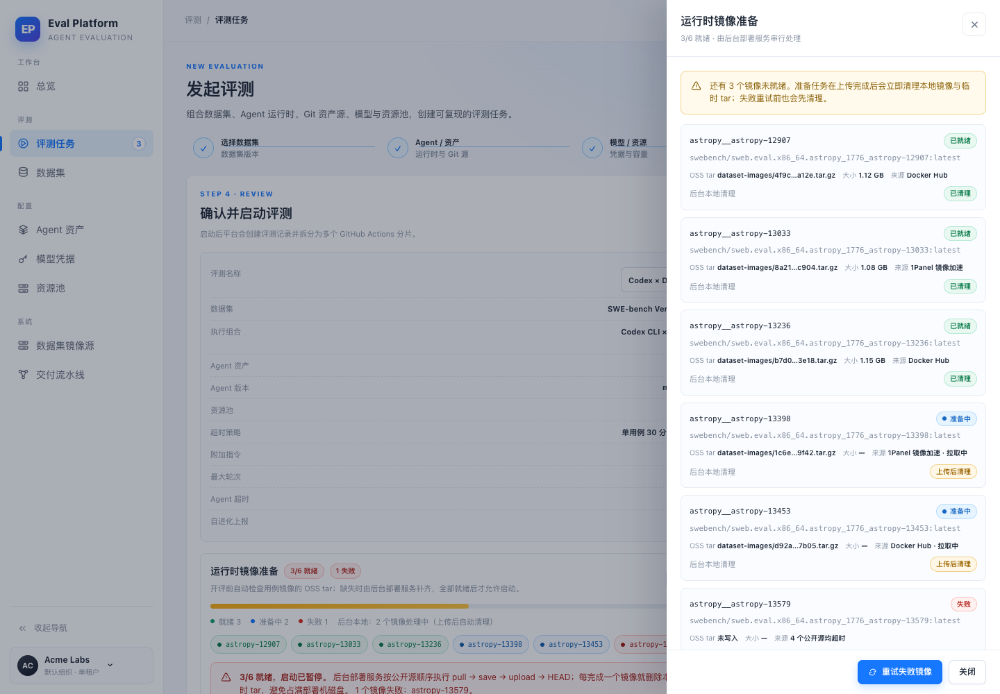

# Preflight and auto-prepare dataset image tarballs; clean backend local residue after upload

English | [中文](m8-dataset-image-preflight-ensure.md)

```yaml flow
kind: issue
milestone: m8
priority: P2
status: ready
scope:
  - .agents/flow/**
  - backend/**
  - deploy/**
  - docs/**
  - plans/**
  - prototype/**
  - runner/**
  - runner-contract/**
  - scripts/**
  - tests/**
  - web/**
adr: []
github:
  number: 290
  url: https://github.com/Shadow-Azure/ai-eval-platform/issues/290
```

## Background

- In production evaluation `c935441d-958a-4d6c-9122-9f217668b7c3`, only the OSS tar for `astropy-12907` existed before the run started; the other five of six SWE-bench case images were still 404 when tasks were dispatched. The runner silently falls back to public registries on a tar 404, with a 180s per-source timeout and a 300s total budget. A cold spot instance cannot pull a 4.16GB image within that budget, so all five cases ended as `image_unavailable`.
- The only current way to write an OSS tar is the manual `scripts/publish-dataset-image.sh` on the fixed host: `docker save` → gzip → presign PUT → HEAD, one image at a time, decoupled from the evaluation flow. `backend/app/services/dataset_image_tarballs.py` only derives the key from the image reference and presigns a GET; it never checks whether the object exists.
- The evaluation preflight in `backend/app/services/preflight.py` checks execution / scoring image digests, dataset, model and runner labels, but not the `environment_image` tar of each case. A missing object is therefore never blocked early; it only surfaces later as “all public sources unavailable” on the runner side.
- The fixed host system disk has only about 2.3GB free, while one image is 4.16GB and its compressed tar is about 1.12GB. Once “pull + save + upload” is automated, failing to delete the local image and temporary tar after upload will quickly fill the backend deployment disk and break the next preparation or evaluation. Cleanup must live in the same pipeline as upload, not only in an operations runbook.

## Goals

- Preflight check: resolve the `environment_image` of the selected cases (deduplicated by image reference), HEAD each OSS tar, and allow evaluation creation only when all exist. When some are missing, return an explicit image readiness state instead of waiting for runner failure.
- Automatic preparation: a preparation worker inside the backend deployment service runs `pull` (using the existing public source order) → `docker save | gzip` → presign PUT → HEAD verification serially, persists status, supports retry, and deduplicates/locks by image so concurrent requests do not upload twice.
- Cleanup after upload: after each image is uploaded and passes HEAD verification, immediately delete the local Docker image and temporary tar. Failures, retries and startup must also clear leftovers from previous attempts. The preparation task keeps at most one image at a time and checks free disk before starting. This is a hard acceptance criterion of this issue; residue must not be left for operators.
- Frontend visibility and gate: the evaluation confirmation step shows “X/Y ready”, “preparing / failed / retry” and “0 local residue”; starting is disabled until all images are ready. The preparation detail lists each image's OSS tar, matched source, size and local cleanup state.
- Keep the existing OSS tar / runner fallback path unchanged; this issue only adds “publish orchestration + readiness gate + cleanup”, not a redesign of the runner's tar-first logic.

## Proposal (suggested)

### 1. State and API

- Add `dataset_image_artifact` (`image_ref` primary key, `object_key`, `status`, `size_bytes`, `source`, `error`, `attempts`, `updated_at`, `prepared_at`) with statuses `missing / preparing / ready / failed`.
- `POST /api/v1/evaluations/prepare` resolves and deduplicates all case images, HEADs their OSS tars, and returns per-image readiness plus the missing list. Missing images are idempotently enqueued for preparation (only one job per key).
- `POST /api/v1/evaluations` rechecks before creation; if any image is not `ready`, it returns `409 image_not_ready` with `images[]` (key, status, error) and does not create the run.
- `GET /api/v1/dataset-images/artifacts?image=...` lets the frontend poll; `POST /api/v1/dataset-images/artifacts/retry` lets an administrator retry failed images. Retry never bypasses cleanup.

### 2. Preparation worker and cleanup

- Add an independent preparation worker inside the backend deployment service (compose stack) that reuses the API's OSS/S3 settings and public source list; it does not depend on an operator logging in to the fixed host.
- Lock by `image_ref` and process serially: a HEAD hit goes straight to `ready`; otherwise pull from public sources in order, write a temporary tar via `docker save | gzip`, presign PUT, verify with HEAD and size, then mark `ready`.
- Cleanup order: HEAD passes → delete the temporary tar → `docker image rm <image>` → record `local_cleanup=done`. Any pull/save/upload/HEAD failure also deletes the temporary tar and any pulled image before exiting. On process start, scan and remove temporary directories and leftover images created by this worker.
- Disk protection: check free space before preparation (at least 2× the estimated compressed tar), mark `failed` and ask for more capacity when short, and process only one image at a time so concurrent pulls cannot fill the disk.
- Do not delete platform runtime images (api/web/dispatcher and so on); only clean the `image_ref` values involved in this preparation and `dataset-image-*` temporary files.

### 3. Frontend

- Add a “runtime image preparation” card to evaluation Step 4: progress bar, ready/preparing/failed counts, one chip per image, failure reason, retry/recheck, and a preparation detail drawer.
- Disable “Start evaluation” with `Waiting for images (3/6)` until every image is ready; only then allow starting.
- The card always shows “Backend local: 0 images / 0 temporary tars (cleaned after upload)”; the detail drawer shows each image's OSS tar, matched source, size, local cleanup state and cleanup policy.
- The frontend only displays and triggers; it never holds OSS credentials. Failure reasons come from the backend status API.

### 4. Out of scope

- Scale-out options such as private ACR sync, P2P / Dragonfly and node prewarming.
- Public-source probing and blocking during dataset import (already covered by #234 / #236).
- Runner-side tar download/fallback, failure codes and timeout budget (already covered by #273), unless integration reveals a required contract fix.

## Acceptance

- With six case images and three existing tars, only the three missing ones are enqueued; after preparation all six are `ready` and the evaluation can be created. If the pre-create HEAD check fails, the API returns `409 image_not_ready` and lists the images.
- After each successful upload, that `image_ref` does not exist on the deployment host and the temporary tar directory is empty; failure and retry paths leave no residue either; worker startup cleanup removes images/temporary files left by an interrupted run.
- Concurrent triggers for the same image produce only one upload; repeated prepare calls are idempotent; failures record `source`, `error` and `attempts`, and retries use backoff.
- The frontend correctly renders the 3/6, 6/6 and failed states and cannot start before readiness; the local cleanup state in the preparation detail matches reality.
- Regression: the existing OSS tar presign, runner tar-first path and public-source fallback are unchanged; backend pytest, runner tests, `npm test`, `npm run verify:docs` and `npm run verify:flow` pass.
- Documentation: `docs/architecture.md`, `docs/development.md` and `runner/README.md` describe automatic preparation, the status API and cleanup constraints; Chinese/English pairing and i18n records pass the gates.

## Frontend prototype (Before / After)

Before: evaluation Step 4 only reviewed configuration and offered “Start evaluation”; there was no way to see whether image tars were ready.

After: Step 4 adds a runtime image preparation card. With 3/6 ready, starting is disabled; after preparation completes, all 6/6 are ready and starting is enabled, with a note that backend local images and temporary tars were cleaned after upload. The preparation detail drawer shows per-image state and cleanup results.

| Scenario | Screenshot |
| --- | --- |
| Before · Step 4 without image readiness |  |
| After · 3/6 ready, start paused |  |
| After · 6/6 ready, can start |  |
| After · preparation detail and local cleanup |  |

The prototype only simulates check/preparation states; it performs no real Docker/OSS operations. The real implementation follows the status API and worker described above.

## Risks and trade-offs

- The first evaluation must wait for preparation (minutes per image); this is the necessary cost of moving failure from the runner to preflight. A tar hit adds no wait.
- Public sources can still time out; failures block starting with a retry/switch-source hint instead of silently falling back to the runner's 300-second budget.
- Cleanup must target only this preparation's images; deleting a platform runtime image would directly break the service. Use an explicit `image_ref` allowlist and temporary-directory prefix, and cover it with tests.
- The fixed host disk remains limited; this issue starts with serial processing and a disk threshold, leaving an independent builder / streaming upload to a later scale-out issue.
