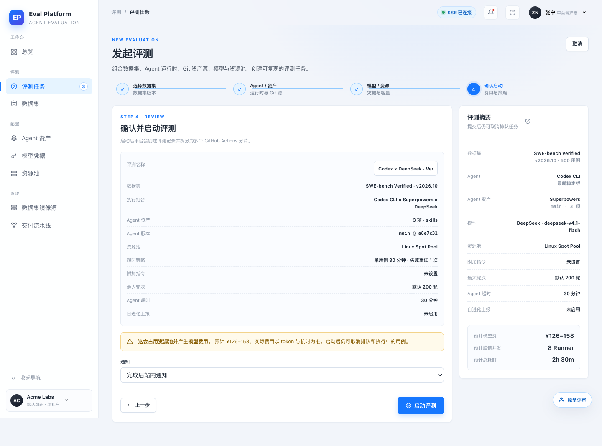
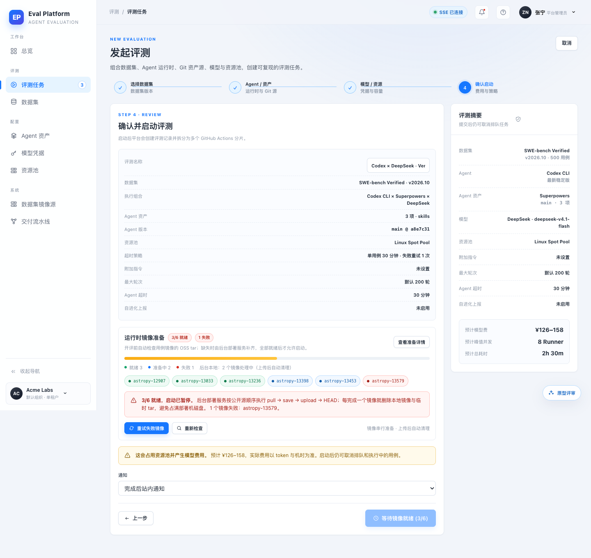
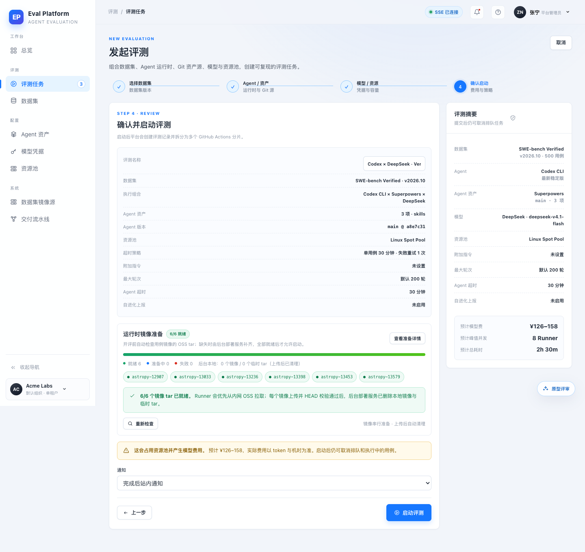
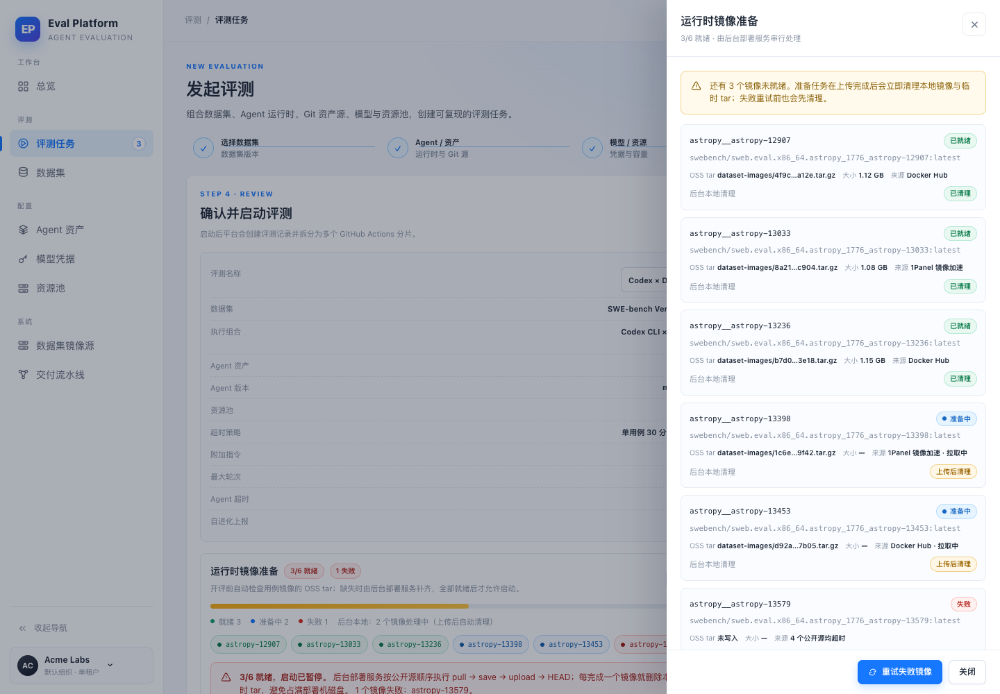

# 评测前自动检查/补齐数据集镜像 tar，上传后清理后台本地残留

[English](m8-dataset-image-preflight-ensure.en.md) | 中文

```yaml flow
kind: issue
milestone: m8
priority: P2
status: ready
scope:
  - .agents/flow/**
  - backend/**
  - deploy/**
  - docs/**
  - plans/**
  - prototype/**
  - runner/**
  - runner-contract/**
  - scripts/**
  - tests/**
  - web/**
adr: []
github:
  number: 290
  url: https://github.com/Shadow-Azure/ai-eval-platform/issues/290
```

## 背景

- 生产评测 `c935441d-958a-4d6c-9122-9f217668b7c3` 的 6 个 SWE-bench 用例镜像中，只有 `astropy-12907` 的 OSS tar 在评测开始前存在，其余 5 个在任务下发时仍是 404。Runner 对 tar 404 静默回退公开源，单源 180s、总预算 300s，冷启动 spot 在预算内拉不完 4.16GB 镜像，5 个用例全部 `image_unavailable`。
- 当前 OSS tar 唯一的写入方式是人工在固定主机执行 `scripts/publish-dataset-image.sh`：`docker save` → gzip → presign PUT → HEAD，一次一个镜像，和评测流程没有耦合。`backend/app/services/dataset_image_tarballs.py` 只按镜像引用派生 key 并 presign GET，不检查对象是否存在。
- 评测预检 `backend/app/services/preflight.py` 只检查 execution / scoring 镜像 digest、数据集、模型和 Runner 标签，不检查每个 case 的 `environment_image` tar。因此缺对象不会被提前阻断，只会表现为 Runner 侧“所有公开源均不可用”。
- 固定主机系统盘只剩约 2.3GB，而单镜像 4.16GB、压缩 tar 约 1.12GB。一旦把“拉取 + 保存 + 上传”自动化，如果上传后不删除本地镜像和临时 tar，后台部署服务磁盘会被残留镜像迅速占满，下一次准备或评测直接失败。清理必须和上传同一条流水线，不能只写在运维手册里。

## 目标

- 开评前检查：解析本次选中用例的 `environment_image`（按镜像引用去重），逐个 HEAD OSS tar；全部存在才允许创建评测，缺失时返回明确的镜像就绪状态而不是等 Runner 失败。
- 缺失自动补齐：由后台部署服务内的准备 worker 串行执行 `pull`（按已有公开源顺序）→ `docker save | gzip` → presign PUT → HEAD 校验；状态落库，失败可重试，按镜像去重/加锁避免并发重复上传。
- 上传后清理：每个镜像在上传并通过 HEAD 校验后，立即删除本地 docker 镜像和临时 tar；失败、重试、启动时都要清理上次残留；准备任务同一时刻只保留一个镜像，进入前检查磁盘余量。这是本 issue 的硬验收，不允许把残留留给人工处理。
- 前端可见与阻断：发起评测确认页显示“X/Y 就绪”“准备中/失败/重试”“后台本地残留 0”等状态；未全部就绪时禁用启动；准备详情列出每个镜像的 OSS tar、命中源、大小和本地清理状态。
- 保持现有 OSS tar / Runner 回退路径不变；本 issue 只补“发布编排 + 就绪门禁 + 清理”，不改造 Runner 的 tar 优先逻辑。

## 方案（建议）

### 1. 状态与接口

- 新增 `dataset_image_artifact`（`image_ref` 主键、`object_key`、`status`、`size_bytes`、`source`、`error`、`attempts`、`updated_at`、`prepared_at`），状态集合 `missing / preparing / ready / failed`。
- `POST /api/v1/evaluations/prepare` 解析并去重全部用例镜像，HEAD OSS tar；返回每个镜像的就绪状态与缺失列表。缺失时自动幂等入队准备任务（同 key 只允许一个 job）。
- `POST /api/v1/evaluations` 创建前再次检查；存在非 `ready` 镜像时返回 `409 image_not_ready`，附 `images[]`（key、status、error），不创建 run。
- `GET /api/v1/dataset-images/artifacts?image=...` 供前端轮询；`POST /api/v1/dataset-images/artifacts/retry` 供管理员重试失败镜像。重试不绕过清理。

### 2. 准备 worker 与清理

- 在后台部署服务（compose 栈）内新增独立准备 worker，复用 API 的 OSS/S3 配置和公开源列表；不依赖固定主机人工登录。
- 按 `image_ref` 加锁并串行处理：HEAD 命中 → 直接 `ready`；否则按公开源顺序 pull，`docker save | gzip` 写临时 tar，presign PUT，HEAD 校验大小后写 `ready`。
- 清理顺序：HEAD 通过 → 删除临时 tar → `docker image rm <image>` → 记录 `local_cleanup=done`；pull/save/upload/HEAD 任一步失败也删除临时 tar 和已拉取的镜像后再退出。进程启动时扫描并清理本 worker 创建的临时目录与残留镜像。
- 磁盘保护：准备前检查可用空间（至少 2× 压缩 tar 估算），不足则标记 `failed` 并提示扩容；同一时刻只处理一个镜像，避免并发拉取占满磁盘。
- 不删除平台自身运行镜像（api/web/dispatcher 等）；只清理本次准备涉及的 `image_ref` 与 `dataset-image-*` 临时文件。

### 3. 前端

- 发起评测 Step 4 增加“运行时镜像准备”卡片：进度条、就绪/准备中/失败计数、每个镜像 chip、失败原因、重试/重新检查、准备详情抽屉。
- 未全部就绪时“启动评测”禁用并显示 `等待镜像就绪 (3/6)`；全部就绪后才可启动。
- 卡片常驻展示“后台本地：0 个镜像 / 0 个临时 tar（上传后已清理）”；详情抽屉展示每个镜像的 OSS tar、命中源、大小、本地清理状态和清理策略。
- 前端只做展示与触发，不直接持有 OSS 凭据；失败原因来自后端状态接口。

### 4. 不在本 issue 范围

- 私有 ACR 同步、P2P / Dragonfly、节点预热等规模化方案。
- 数据集导入时的公开源探测与阻断（已由 #234 / #236 覆盖）。
- Runner 侧 tar 下载/回退、失败码与超时预算（已由 #273 覆盖），除非联调发现必须的契约修正。

## 验收

- 6 个用例镜像：3 个已有 tar 时只对缺失的 3 个入队；准备完成后 6/6 `ready`，评测可以创建；创建前的 HEAD 校验不通过时返回 `409 image_not_ready` 并列出镜像。
- 每个镜像成功上传后，部署机上该 `image_ref` 不存在、临时 tar 目录为空；失败和重试路径同样不残留；worker 启动扫描能清掉上次中断留下的镜像/临时文件。
- 并发触发同一镜像只产生一个上传；重复调用 prepare 幂等；失败会记录 `source`、`error`、`attempts`，重试有退避。
- 前端在 3/6、6/6、失败三种状态下显示正确，未就绪时不能启动；准备详情中的本地清理状态与实际一致。
- 回归：现有 OSS tar presign、Runner tar 优先与公开源回退路径不变；backend pytest、runner tests、`npm test`、`npm run verify:docs`、`npm run verify:flow` 通过。
- 文档：`docs/architecture.md`、`docs/development.md`、`runner/README.md` 说明自动准备、状态接口和清理约束，中英配对与 i18n 记录通过门禁。

## 前端原型（Before / After）

修改前：发起评测 Step 4 只有配置复核与“启动评测”，看不到镜像 tar 是否就绪。

修改后：Step 4 增加运行时镜像准备卡片；3/6 就绪时启动被禁用；补齐后 6/6 可启动，并显示上传后已清理后台本地镜像与临时 tar；准备详情抽屉展示逐镜像状态与清理结果。

| 场景 | 截图 |
| --- | --- |
| 修改前 · Step 4 无镜像就绪状态 |  |
| 修改后 · 3/6 就绪，启动暂停 |  |
| 修改后 · 6/6 就绪，可启动 |  |
| 修改后 · 准备详情与本地清理状态 |  |

原型只模拟检查/准备状态，不执行真实 docker/OSS 操作；真实实现按上面的状态接口与 worker 执行。

## 风险与取舍

- 首次开评要等待准备完成（每镜像数分钟）；这是把失败从 Runner 提前到开评前的必要代价。已有 tar 命中时无额外等待。
- 公开源仍可能超时；失败会阻断启动并给出可重试/换源提示，不会静默回退到 Runner 的 300 秒预算。
- 清理必须只针对本次镜像，误删平台运行镜像会直接影响服务；实现时用明确的 `image_ref` 白名单和临时目录前缀，并加测试。
- 固定主机磁盘仍有限；本 issue 先做串行 + 磁盘门槛，独立 builder / 流式上传留到后续规模化 issue。
- 清理只避免多次准备累积，不能解决单次 4.16GB 的峰值占用；当前部署机约 2.3GB 余量下，准备会在磁盘门槛处失败。实现前必须扩容 / 挂数据盘，或改用流式上传 / 独立 builder。
