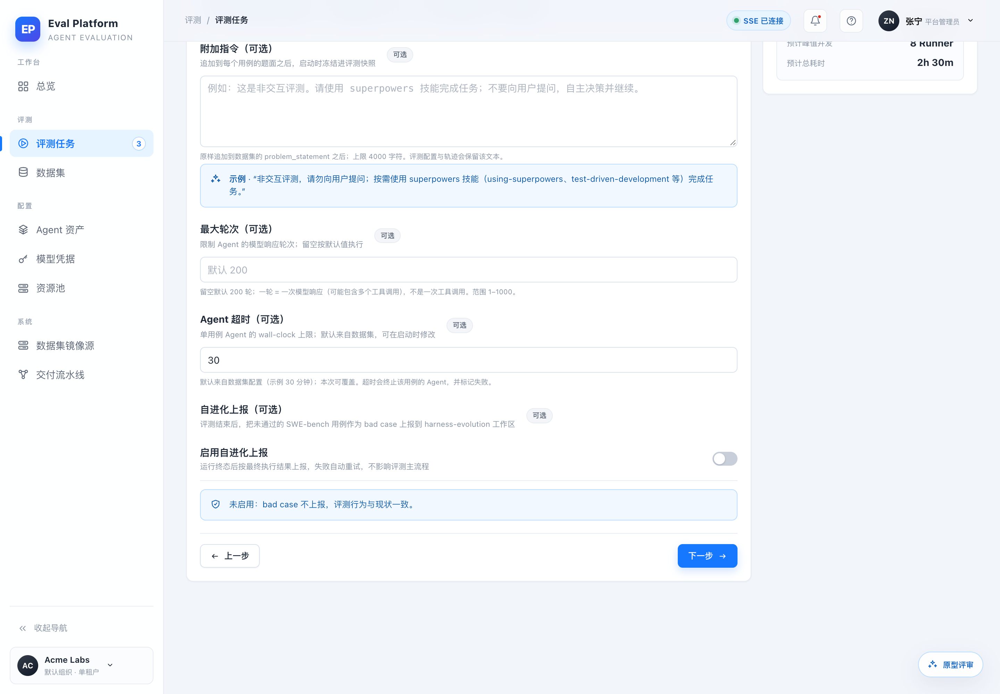
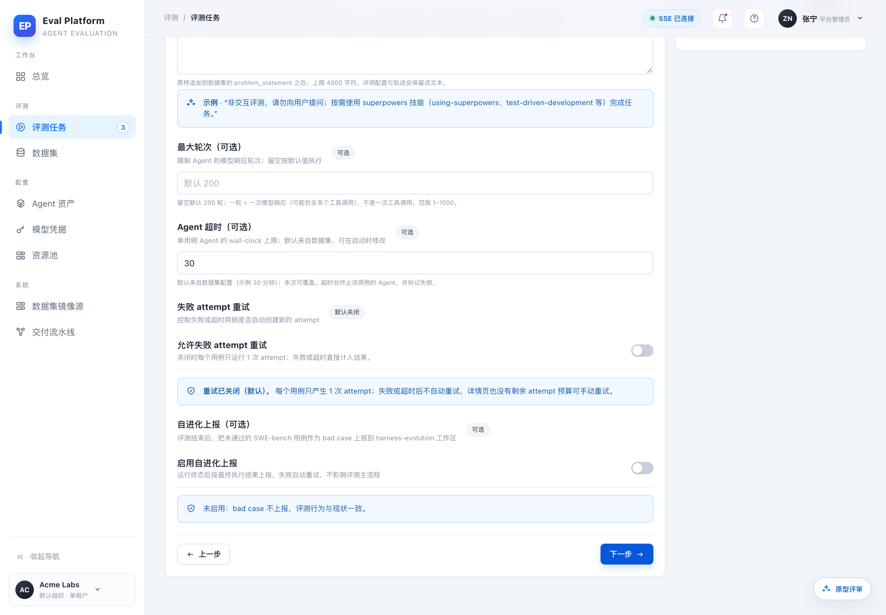
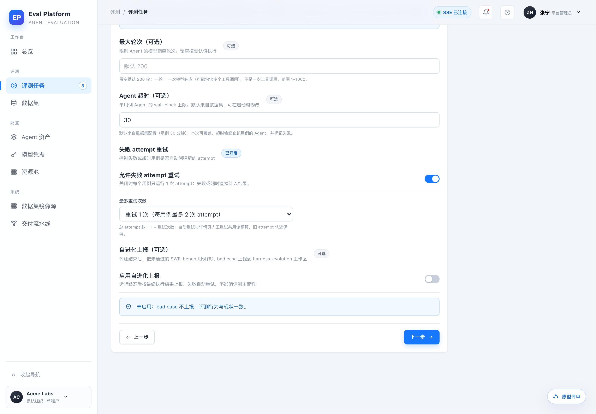
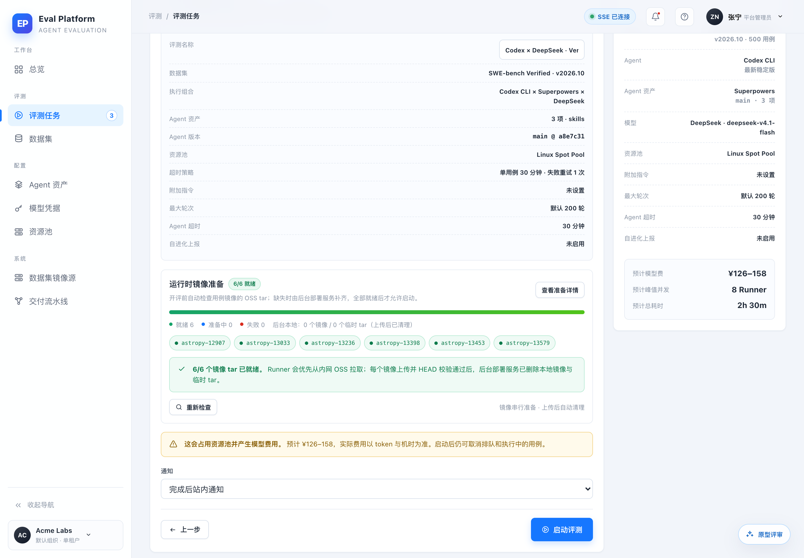
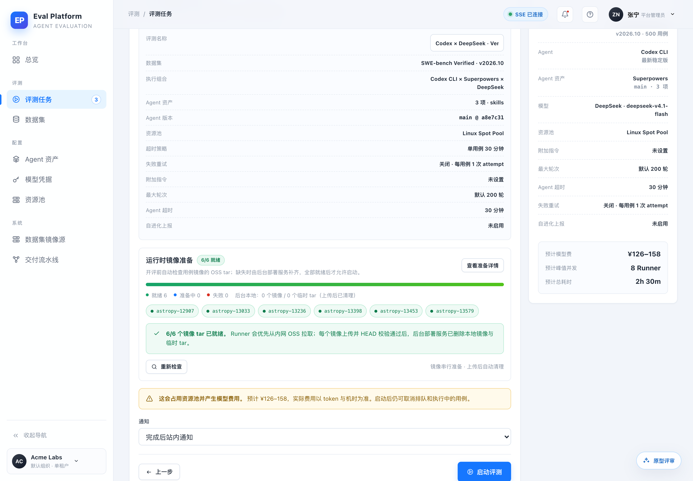
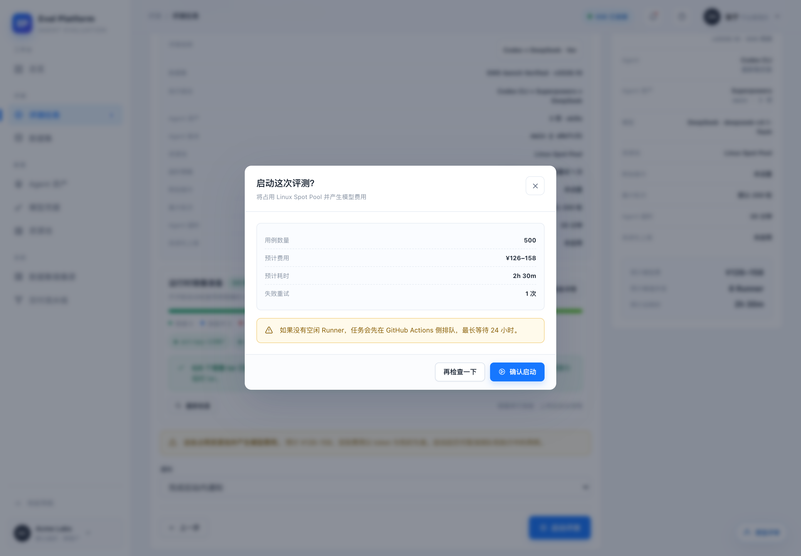
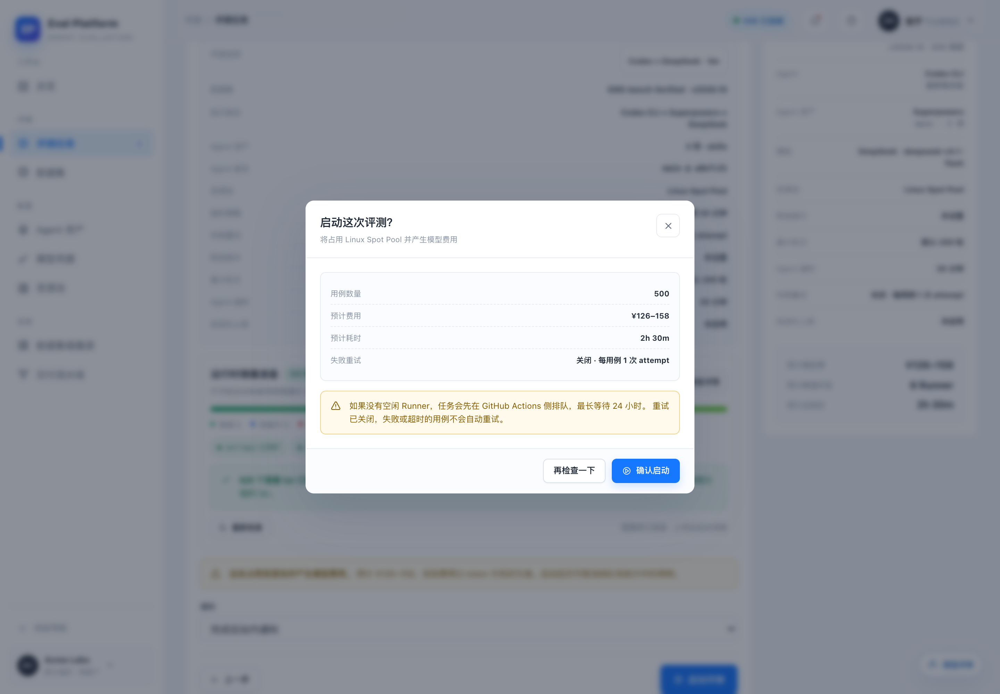

# Add an attempt-retry toggle at evaluation launch (default off)

English | [中文](m8-eval-attempt-retry-toggle.md)

```yaml flow
kind: issue
milestone: m8
priority: P2
status: done
scope:
  - .agents/flow/**
  - prototype/**
  - web/**
  - tests/**
adr: []
github:
  number: 353
  url: https://github.com/Shadow-Azure/ai-eval-platform/issues/353
```

## Background

- The launch wizard currently controls `execution.max_attempts` with a "failed retry count" select under advanced execution policy; the default is 2 (one automatic retry). Automatic failure retries, spot-interruption retries and manual retries from the detail page all share that budget.
- For cost-sensitive runs, reproducing a single attempt, or comparing results from an identical configuration, users often want no retry at all. Today they must manually pick "no retry" on every launch; missing it can silently add model and machine-time cost.
- The prototype launch page has no retry control, while the review step and launch dialog hard-code "failed retries: 1". They neither reflect the real configuration nor express the product decision that retry is off by default.
- This issue replaces the implicit default with an explicit switch: choose at launch whether failed attempts may retry, off by default; it only reuses the existing `max_attempts`, with no backend field, API or migration change.

## Goals

- Add a "failed attempt retry" switch to step 3 of the launch wizard, off by default. When off, each case runs exactly one attempt (`max_attempts=1`); failures and timeouts go straight into the result.
- When on, allow 1–4 retries with `max_attempts = 1 + retries`; automatic and manual retries still share the budget, and old attempt traces are retained.
- The wizard summary aside, step 4 execution policy and launch confirmation dialog read the same state: off shows "off · one attempt per case", on shows "on · up to N retries (at most N+1 attempts per case)". Remove the hard-coded "failed retries: 1".
- When off, state clearly that no attempt budget remains and manual retry from the detail page is unavailable; retrying requires turning the switch on or creating a new evaluation.
- Update `prototype/index.html` in sync and attach before/after screenshots to this issue description.

## Proposal (suggested)

### 1. Frontend (web)

- Change the `EvalWizardPage` `draft.maxAttempts` default to 1; replace the "failed retry count" select with a switch and show the count select only when the switch is on.
- Switch off: hide the count select and force `executionPayload().max_attempts` to 1. Switch on: offer 1–4 retries, default 1, with `max_attempts = retries + 1`.
- Render the same state in the wizard summary aside, step 4 execution policy and launch confirmation dialog; none of those places may hard-code the count.
- When off, explain under the switch that "each case runs one attempt and no budget remains for manual retry after a failure"; when on, explain that "total attempts = 1 + retries, and automatic and manual retries share the budget".
- Do not change other advanced execution policy fields or the create payload shape.

### 2. Prototype

- Insert the same switch and conditional count control after "Agent timeout" in step 3, off by default; the summary aside, step 4 and the launch dialog use the same state.
- Run `node prototype/build-standalone.mjs` to rebuild `prototype/index.html`, and attach before/after screenshots to the issue description.

### 3. Semantics and compatibility

- Reuse `execution.max_attempts`: off = 1, on = 1 + retries; backend, API, database migrations and the Runner contract stay unchanged.
- Keep `max_attempts` on historical evaluations; the new default only affects newly launched evaluations.
- When retry is off, automatic retries, spot-interruption retries and manual retries are all unavailable because the budget is 1; this is the existing `max_attempts` semantics, and this issue does not split the budget.

### 4. Out of scope

- Adding a separate automatic-retry boolean field, or splitting automatic and manual retries into two budgets.
- Per-case, per-failure-type or per-pool retry policies.
- Changing the spot retry cap, the fallback threshold or budget-pause behavior.

## Acceptance

- A new evaluation has retry off by default; without touching the switch, the create request sends `execution.max_attempts = 1`.
- With the switch on and 2 retries selected, the request sends `execution.max_attempts = 3`; turning the switch off and on again keeps the selected count.
- Step 3, the summary aside, step 4 and the launch confirmation dialog show the same state as the request value, and the hard-coded "failed retries: 1" is gone.
- The off-state explanation explicitly says "one attempt per case; no remaining budget for manual retry".
- `prototype/index.html` is rebuilt with `node prototype/build-standalone.mjs`; screenshots cover step 3 default off, step 3 on, step 4 and the launch confirmation dialog.
- `cd web && npm run build` passes; `npm run verify:flow` and `npm run lint:docs` pass.
- The prototype only simulates the interaction and runs no real evaluation; the real implementation only changes the frontend payload, not the backend contract.

## Frontend prototype (Before / After)

Before: step 3 had no retry switch; step 4 and the launch dialog hard-coded "failed retries: 1".

After: step 3 adds a "failed attempt retry" switch, off by default; when off each case runs one attempt, and when on 1–4 retries can be selected; step 4, the summary aside and the launch dialog show the current state.

| Scenario | Screenshot |
| --- | --- |
| Before · step 3 without a retry switch |  |
| After · step 3 default off |  |
| After · step 3 on with 1 retry |  |
| Before · step 4 hard-codes failed retries: 1 |  |
| After · step 4 shows retry off |  |
| Before · launch confirmation hard-codes failed retries: 1 |  |
| After · launch confirmation shows retry off |  |

The prototype only simulates the interaction; the real implementation follows the `max_attempts` mapping above. Screenshots use the same 1440×1000 viewport, light theme and default form state; the after set also shows the switch turned on.

## Risks and trade-offs

- Turning the default off changes the previous default of one automatic retry to zero; evaluations that rely on automatic recovery of transient failures must opt in, and release notes should call out this behavior change.
- Turning retry off also removes the attempt budget for manual retries on the detail page; if the product wants to keep manual retries, a later change should split automatic and manual retries into two budgets, which is a backend contract change.
- The selected count is kept only within the current wizard session; turning the switch off and on again restores the previous count, and leaving the page resets it to 1.
- Only the frontend default and display change; existing evaluations are untouched, and historical data and retry caps remain traceable.
