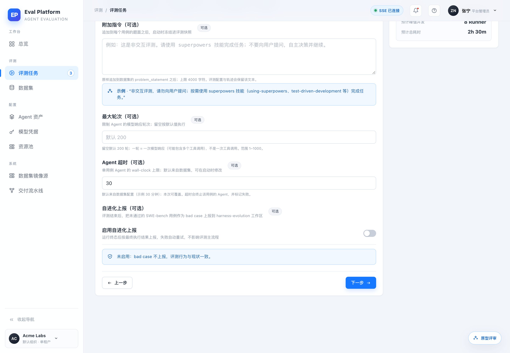
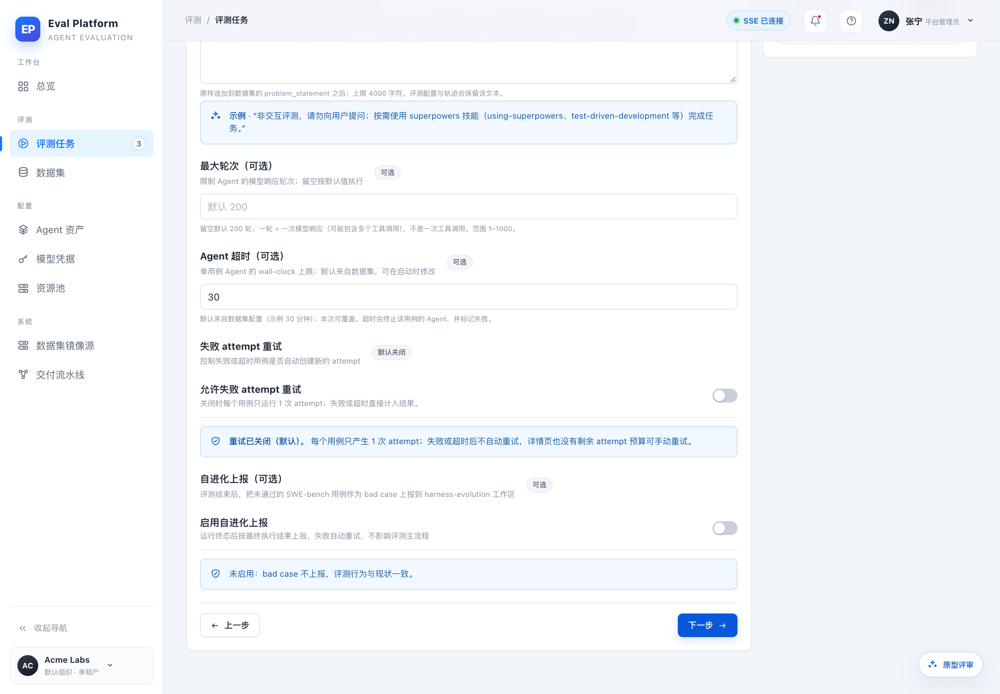
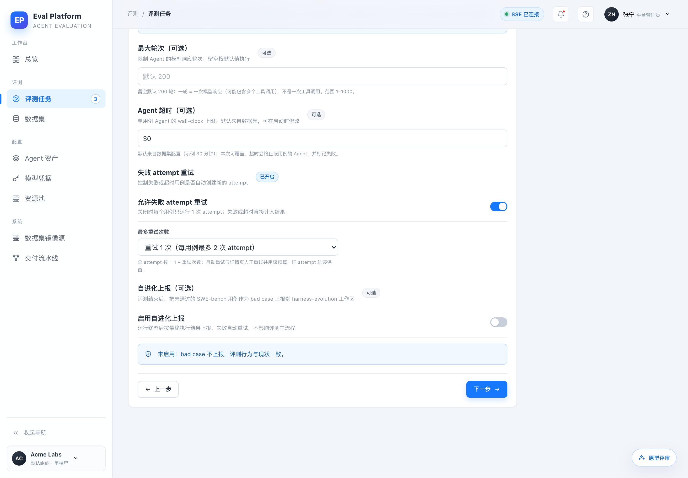
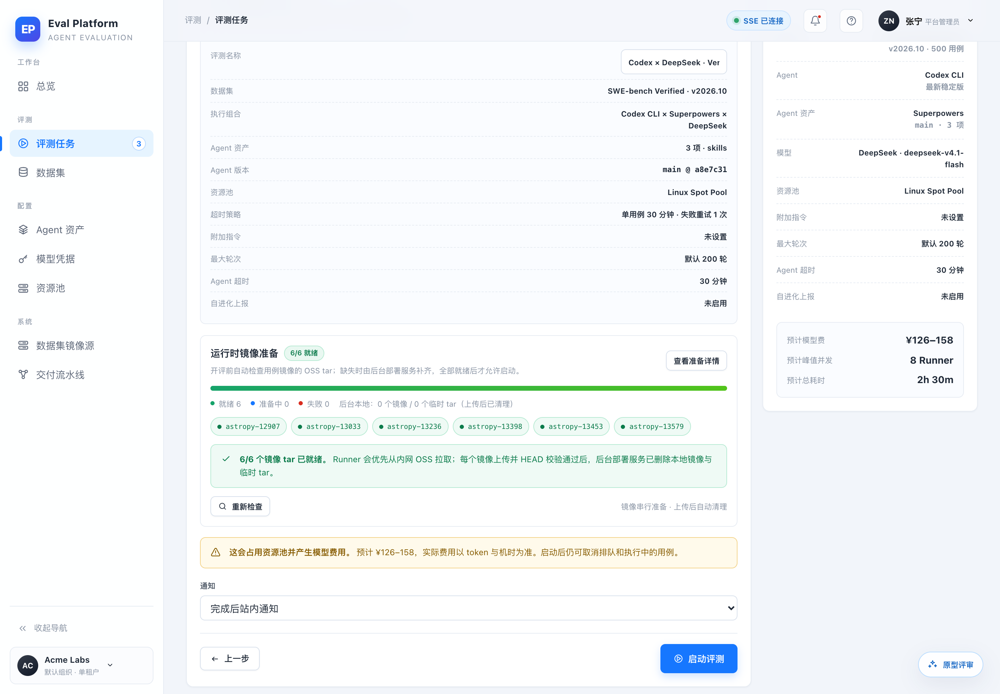
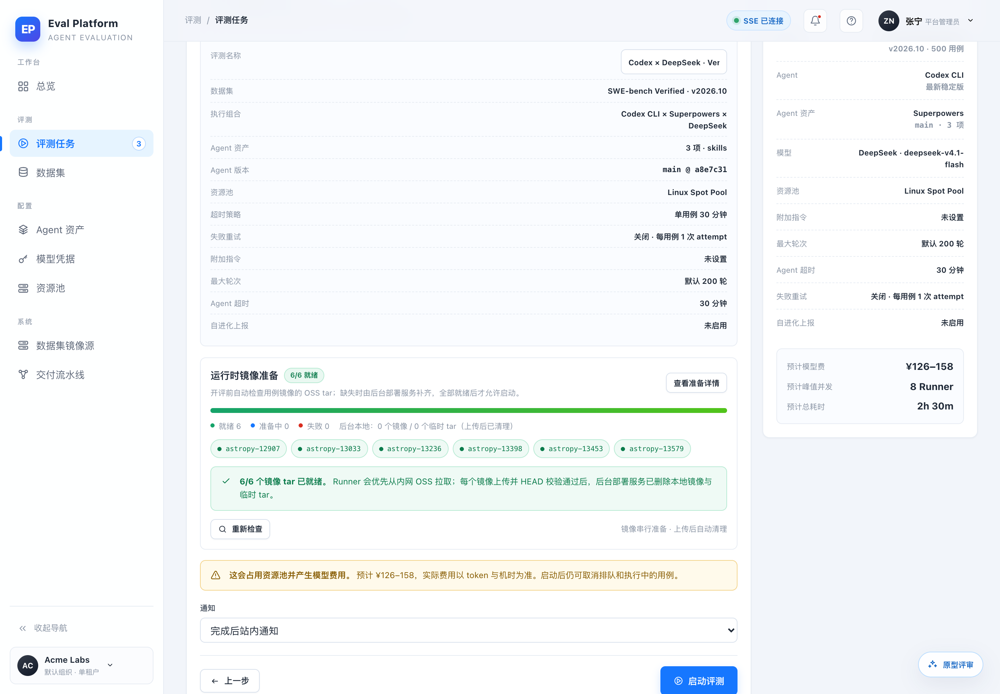
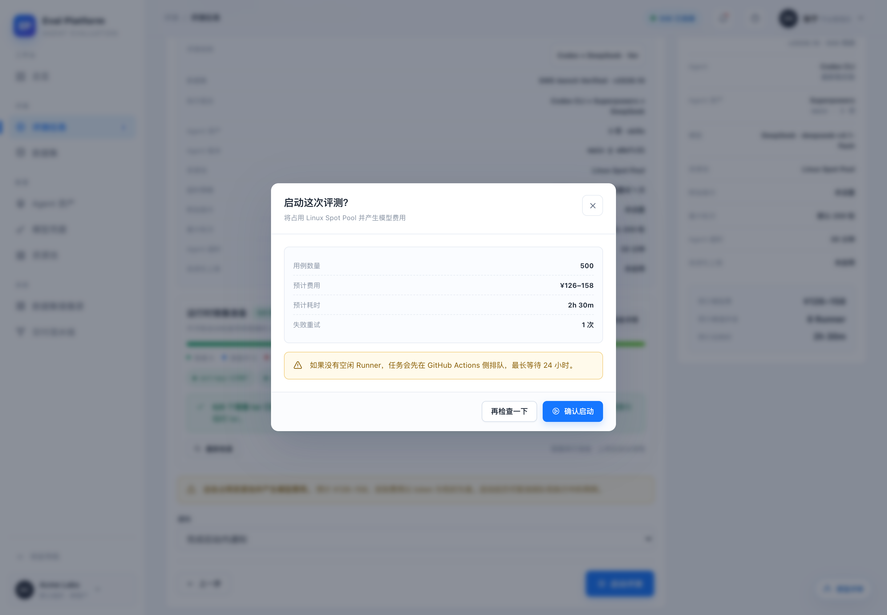
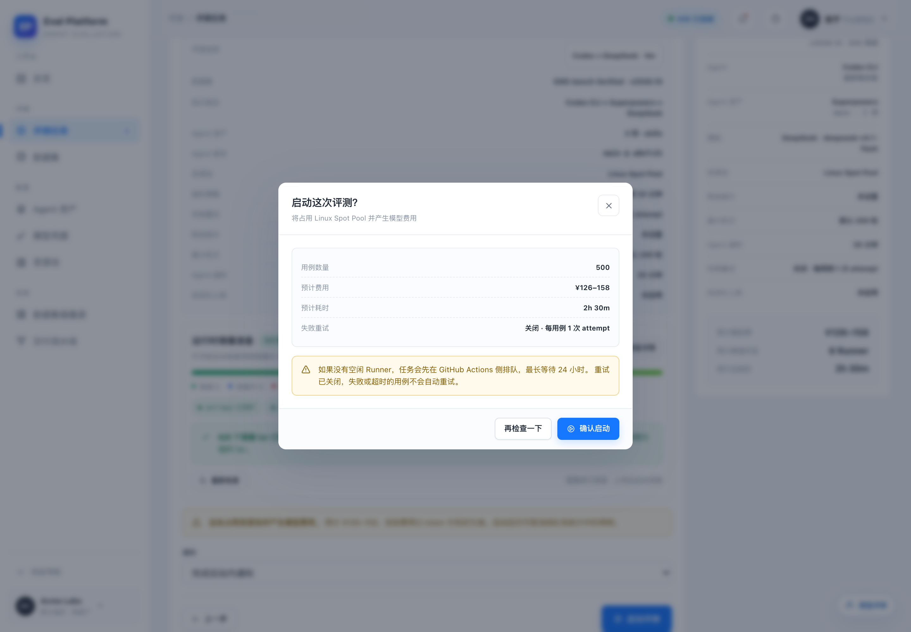

# 评测启动增加 attempt 重试开关（默认关闭）

[English](m8-eval-attempt-retry-toggle.en.md) | 中文

```yaml flow
kind: issue
milestone: m8
priority: P2
status: ready
scope:
  - .agents/flow/**
  - prototype/**
  - web/**
  - tests/**
adr: []
github:
  number: 353
  url: https://github.com/Shadow-Azure/ai-eval-platform/issues/353
```

## 背景

- 发起评测向导当前在「高级执行策略」用「失败重试次数」下拉控制 `execution.max_attempts`，默认 2（即自动重试 1 次）；自动失败重试、spot 中断重试和详情页人工重试共用这一预算。
- 对成本敏感、需要复现单次 attempt 或比较同配置结果的评测，用户往往希望完全不重试；现在每次都要手动选「不重试」，漏选就可能产生额外的模型和机时费用。
- 原型发起评测页尚无重试控制，确认页与启动弹窗写死「失败重试 1 次」，既没有反映真实配置，也没有表达「默认不重试」的产品决策。
- 本 issue 用显式开关替代隐式默认：启动评测时选择是否允许失败 attempt 重试，默认关闭；只复用现有 `max_attempts`，不改后端字段、API 与迁移。

## 目标

- 发起评测第 3 步新增「失败 attempt 重试」开关，默认关闭；关闭时每个用例只执行 1 次 attempt（`max_attempts=1`），失败或超时直接计入结果。
- 开启后可选择最多重试 1–4 次，`max_attempts = 1 + 重试次数`；自动重试与人工重试仍共用该预算，旧 attempt 轨迹保留。
- 向导右侧摘要、Step 4 执行策略与启动确认弹窗读取同一状态：关闭显示「关闭 · 每用例 1 次 attempt」，开启显示「开启 · 最多 N 次（每用例最多 N+1 次 attempt）」；移除写死的「失败重试 1 次」。
- 关闭时在界面明确说明没有剩余 attempt 预算，详情页人工重试不可用；需要重试应开启开关或重新发起评测。
- 原型 `prototype/index.html` 同步更新，并在本 issue 描述中附修改前后截图。

## 方案（建议）

### 1. 前端（web）

- `EvalWizardPage` 的 `draft.maxAttempts` 默认值改为 1；把「失败重试次数」下拉替换为开关，开关打开时才显示次数下拉。
- 开关关闭：不显示次数下拉，`executionPayload().max_attempts` 固定为 1；开启：次数选项为 1–4，默认 1，`max_attempts = 次数 + 1`。
- 同一状态渲染到向导右侧摘要、Step 4「执行策略」和启动确认弹窗；这些位置不得再写死次数。
- 关闭时在开关下方说明「每个用例只执行 1 次 attempt，失败或超时后没有剩余预算可手动重试」；开启时说明「总 attempt 数 = 1 + 重试次数，自动重试与人工重试共用预算」。
- 不改「高级执行策略」其他字段，也不改提交 payload 的结构。

### 2. 原型

- 在 Step 3「Agent 超时」之后插入同一组开关与条件次数控件，默认关闭；右侧摘要、Step 4 与启动弹窗使用同一状态。
- 运行 `node prototype/build-standalone.mjs` 重新生成 `prototype/index.html`，在 issue 描述中附修改前后截图。

### 3. 语义与兼容

- 复用 `execution.max_attempts`：关闭 = 1，开启 = 1 + 次数；后端、API、数据库迁移和 Runner 契约不变。
- 历史评测的 `max_attempts` 保持不变；新默认只影响新发起的评测。
- 关闭重试时，自动重试、spot 中断重试和人工重试都因预算为 1 而不可用；这是现有 `max_attempts` 语义，本 issue 不拆分预算。

### 4. 不在本 issue 范围

- 新增独立的自动重试布尔字段，或把自动重试与人工重试拆成两个预算。
- 按用例、失败类型或资源池配置不同的重试策略。
- 改变 spot 重试次数上限、回退阈值或预算暂停行为。

## 验收

- 新发起评测默认关闭重试；不操作开关时创建请求的 `execution.max_attempts` 为 1。
- 开启并选择 2 次时请求的 `execution.max_attempts` 为 3；关闭后再开启保留用户选择的次数。
- Step 3、右侧摘要、Step 4 和启动确认弹窗显示的开关状态与请求值一致，不再出现写死的「失败重试 1 次」。
- 关闭状态的说明明确写出「每用例 1 次 attempt；人工重试无剩余预算」。
- `prototype/index.html` 由 `node prototype/build-standalone.mjs` 重新生成；截图覆盖 Step 3 默认关闭、Step 3 开启、Step 4 与启动确认弹窗。
- `cd web && npm run build` 通过；`npm run verify:flow` 与 `npm run lint:docs` 通过。
- 原型只模拟交互，不执行真实评测；真实实现只改前端 payload，不改后端契约。

## 前端原型（Before / After）

修改前：Step 3 没有重试开关；Step 4 与启动弹窗写死「失败重试 1 次」。

修改后：Step 3 增加「失败 attempt 重试」开关，默认关闭；关闭时每个用例 1 次 attempt，开启后可选择 1–4 次；Step 4、右侧摘要与启动弹窗同步显示当前状态。

| 场景 | 截图 |
| --- | --- |
| 修改前 · Step 3 无重试开关 |  |
| 修改后 · Step 3 默认关闭 |  |
| 修改后 · Step 3 开启并选择 1 次 |  |
| 修改前 · Step 4 写死失败重试 1 次 |  |
| 修改后 · Step 4 显示重试关闭 |  |
| 修改前 · 启动确认写死失败重试 1 次 |  |
| 修改后 · 启动确认显示重试关闭 |  |

原型只模拟交互；真实实现按上面的 `max_attempts` 映射执行。截图使用同一 1440×1000 视口、浅色主题与默认表单状态，修改后额外展示开关开启态。

## 风险与取舍

- 默认关闭会把原来的默认 1 次自动重试改为 0 次；依赖自动恢复瞬时失败的评测需要显式开启，发布说明应提示这一行为变化。
- 关闭重试也关闭了详情页人工重试的预算；如果产品希望保留人工重试，需要后续把自动重试与人工重试拆成两个预算，属于后端契约变更。
- 开关次数只在当前向导会话内保留；关闭后再次开启恢复上次次数，离开页面后回到默认 1。
- 只改前端默认值和展示，不改变已有评测；历史数据与重试上限继续可追溯。
