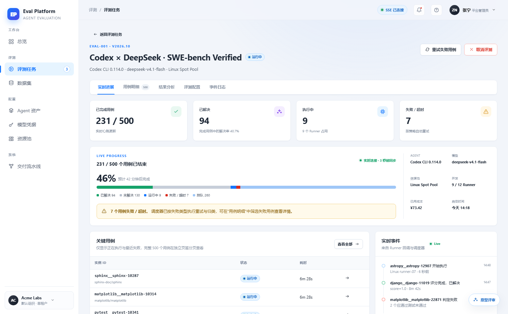
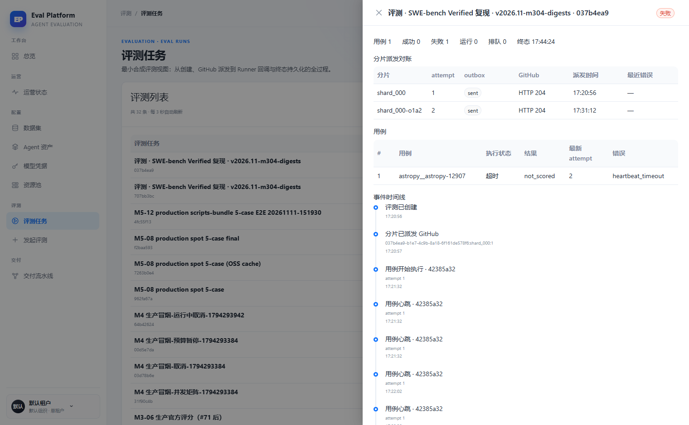

> 来源：`.agents/flow/issues/m5-17-eval-detail-entry.md` · 对比报告：reports/2026-11-11/ui-vs-prototype/对比报告.md

[English](m5-17-eval-detail-entry.en.md) | 中文

## 背景

原型将评测详情设计为独立路由页（`#/evals/eval-001`），含五个页签：实时进展、用例明细、结果分析、评测配置、事件日志；头部有 4 张统计卡、状态堆叠进度条（图例/排队数/预计完成时间）、模型/资源池/并发/成本面板，以及"重试失败用例"。线上实现（2026-11-11 对比报告）入口退化为列表页右侧 Drawer 单列堆叠（分片对账 → 用例表 → 事件时间线），无指标聚合、无结果分析、无重试；`web/src/app/routes.tsx` 的 `/evals/:id` 路由与 `EvalDetailPage.tsx` 存在但不可达（死代码）。证据截图：

| 原型 | 线上 Drawer |
|---|---|
|  |  |

注意：本地 main 已合入 m5-05 结果工作台与 m6-05 轨迹查看器代码，线上部署版本落后（总览页显示"M3 建设中"）。动手前先核实部署版本，避免重复实现。

## 目标

- 恢复 `/evals/:id` 独立路由为唯一详情入口（列表"详情"按钮跳转路由），清理 Drawer 或将其保留为列表页快速预览（ADR 决策）。
- 详情页恢复五个页签；实时进展保留 SSE；用例明细复用 m5-14 的用例浏览组件。
- 头部统计卡与状态堆叠进度条来自服务端聚合（解决率、失败/超时数、预计完成时间），状态枚举与 m5-16 共用同一 ADR。
- 提供"重试失败用例"入口，走后端 API 并受预算/容量约束。
- 保留线上增量："分片派发对账"表与 attempt 心跳时间线（可放入事件日志或独立页签），并反哺原型文档。
- 打通从用例行进入会话轨迹（m6-05）的入口。

## 验收

- 浏览器直链 `/evals/:id` 可达详情页，刷新不丢失。
- 指标、进度、预计完成时间来自服务端聚合，前端不拼凑。
- 重试失败用例产生新的 attempt 记录，预算与容量不足时有明确提示。
- 分片对账与心跳时间线在详情页可见。
- 从失败用例可进入会话轨迹页。
- 死代码清理完成，`verify:flow` 与前端测试绿。
