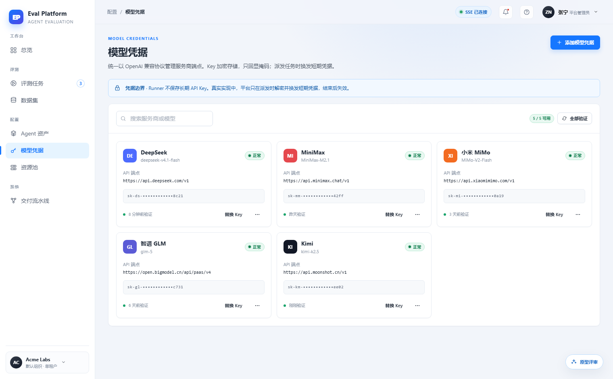
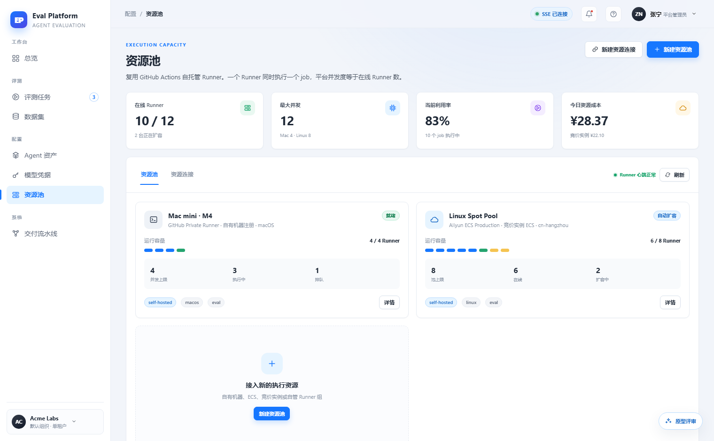
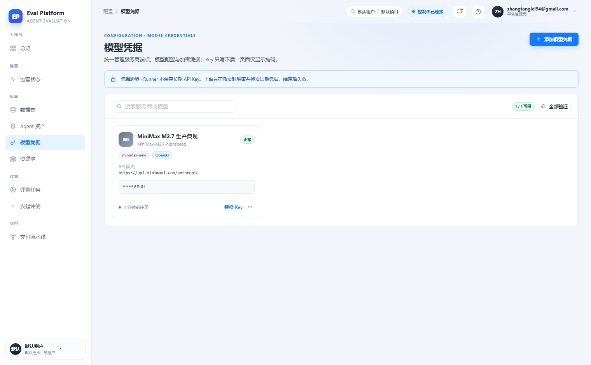

> 来源：`.agents/flow/issues/m5-20-ui-edge-states.md` · 对比报告：reports/2026-11-11/ui-vs-prototype/对比报告.md

[English](m5-20-ui-edge-states.en.md) | 中文

## 背景

`prototype/README.md` 定义了 UI 状态矩阵（空态、加载中、失败、无权限、部分成功、危险操作、凭据掩码、容量不足、连接能力不匹配、Ref 未解析、运行时前置缺失、轨迹降级）。2026-11-11 对比报告发现线上实现整体覆盖不足：模型凭据搜索无结果空态未见、资源连接密钥"锁定态 + 权限申请"未见、Agent 资产"运行时前置缺失"（OpenSpec CLI/生成型 Command 依赖）未见、容量不足排队风险弱化（m5-19 单独处理）。证据截图：

| 原型凭据空态示例 | 原型资源池边界状态 | 线上凭据 |
|---|---|---|
|  |  |  |

## 目标

- 建立边界状态验收清单，逐项对照 `prototype/README.md` 状态矩阵。
- 补齐四类缺失状态：搜索无结果空态（含清除筛选）、资源连接密钥锁定态与权限申请入口、Agent 资产运行时前置缺失标注、危险操作确认文案（不可逆范围 + 已产生费用）。
- 各状态的触发条件由真实权限/数据驱动，不做前端假状态。
- 本 issue 以验收清单为主，具体状态实现随 m5-13 ~ m5-19 各页面自带完成。

## 验收

- 状态矩阵逐项在验收清单中标注：已实现（附截图证据）/ 不适用（附原因）。
- 四类缺失状态各有一条可复现的演示路径（账号、操作步骤、预期展示）。
- 无权限角色的锁定态在真实受限账号下验证。
- 全部截图证据归档到 `reports/` 并在清单中链接。
